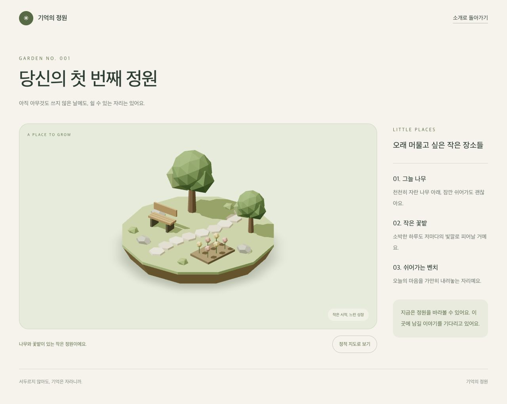
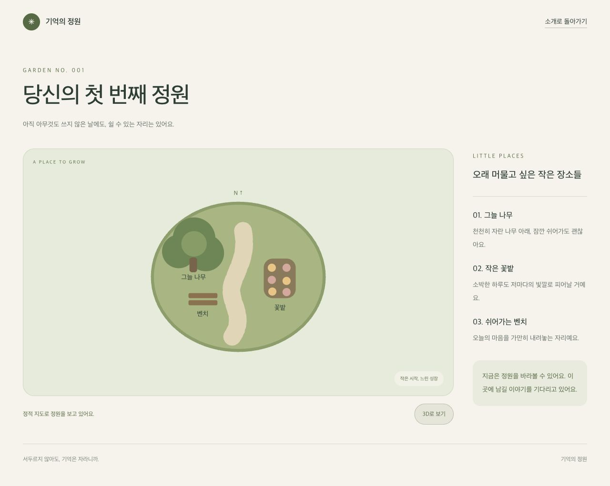
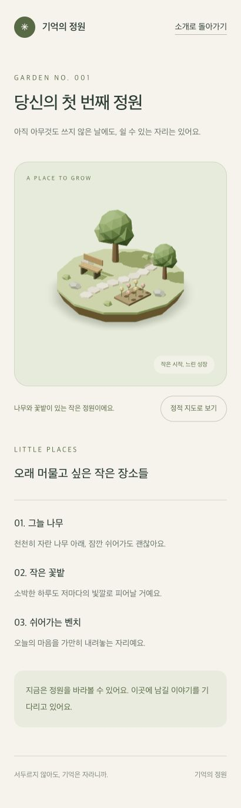

# 2026-11-03 프론트엔드 개발일지 — 실행 가능한 앱에서 첫 3D 정원까지

> 기준 날짜: 2026년 11월 3일, Asia/Seoul. 이 글은 오늘의 대화·명령 실행 결과·병합된 소스를 바탕으로 작성했다. 기능 구현과 검증의 기준 커밋은 `fbb465a`다. 아래에서 비교하는 대안은 선택 이유를 설명하기 위한 것이며, 별도로 명시하지 않은 대안을 모두 구현하거나 성능 비교 실험했다는 뜻은 아니다.

## 1. 오늘의 출발점과 실제 도착점

작업 시작 시 저장소에는 제품 설계, 기여 규칙, GitHub 템플릿, 저장소 검증기와 로컬 에이전트 하네스가 있었다. 하지만 사용자가 브라우저에서 열 수 있는 Next.js 애플리케이션은 없었다. 따라서 첫 과제는 정원을 꾸미는 것보다 먼저, 기존 저장소를 보존하면서 제품을 실행하고 검사할 수 있는 기반을 만드는 일이었다.

오늘의 필수 목표는 Next.js 초기화와 품질 검사 연결이었다. 추가 목표였던 첫 3D 장면까지 구현했고, 마지막에는 참고 자료 문서·앱 초기화·3D 정원 PR을 모두 `main`에 병합했다.

| 구분 | 오늘 시작 전 | 오늘 완료 후 |
| --- | --- | --- |
| 제품 실행 | 실행 가능한 웹 앱 없음 | `/` 소개 화면과 `/garden` 미리보기 실행 |
| 프론트엔드 기반 | 예정 기술 스택만 정해짐 | Next.js 16·React 19·strict TypeScript·Tailwind v4 구성 |
| 폴더 구조 | 제품 소스 없음 | FSD 루트와 실제 welcome/garden-preview 위젯 구성 |
| 3D | 설계·참고 자료 단계 | 코드로 만든 흙섬·나무·벤치·꽃밭·돌길 표시 |
| 접근 실패 처리 | 미구현 | 초기화 실패·실행 중 context loss에 정적 지도 제공 |
| 자동 검사 | 기존 저장소·하네스 검사 | 포맷·린트·타입·기존 단위 테스트·빌드·브라우저 검사 연결 |
| GitHub 운영 | 다른 사람의 승인 1명 필수 | 1인 프로젝트에 맞게 필수 승인만 해제, PR·CI 보호 유지 |

이날 완료한 것은 **첫 정원 미리보기**다. 캐릭터 이동, 충돌, 일기 작성·저장, 이미지 업로드, 로그인, 실제 기록에 따른 정원 성장, 달력, AI 초안 생성은 구현하지 않았다. 화면에 보이는 나무와 꽃은 사용자 기록에서 만들어진 데이터가 아니라 직접 배치한 미리보기 소품이다.



## 2. 작업 순서와 결과를 추적할 수 있는 근거

| 순서 | 작업 | 관련 이슈·PR | 최종 결과 |
| --- | --- | --- | --- |
| 1 | 전날 남긴 3D 참고 자료 문서 정리 | [PR #6](https://github.com/Debuging-JunSeoPark/memory-garden/pull/6) | 지정한 참고 순서·관심 항목 저장, README·에이전트 기억 연결 |
| 2 | 실제 프론트엔드 앱과 품질 도구 구성 | [Issue #5](https://github.com/Debuging-JunSeoPark/memory-garden/issues/5), [PR #7](https://github.com/Debuging-JunSeoPark/memory-garden/pull/7) | 개발 서버, 소개 화면, FSD, CI와 브라우저 스모크 검사 구성 |
| 3 | 첫 정원과 실패 복구 구현 | [Issue #8](https://github.com/Debuging-JunSeoPark/memory-garden/issues/8), [PR #9](https://github.com/Debuging-JunSeoPark/memory-garden/pull/9) | 3D/정적 지도 전환, 렌더러 오류·context loss 대응 |
| 4 | 1인 프로젝트 보호 규칙 수정 | 사용자 확인 후 GitHub 설정 변경 | 필수 승인 해제, 나머지 보호 규칙 유지 |
| 5 | 충돌 해결과 순차 병합 | #6 → #7 → #9 | 모두 main 반영, #5·#8 완료 종료 |

`main`에는 Squash Merge 결과가 다음과 같이 남았다.

```text
d11f110 docs: record 3d implementation references (#6)
9dbae2c build: initialize Next.js application (#7)
fbb465a feat: render the first 3D garden preview (#9)
```

최종 `main` 검사는 [GitHub Actions 실행 41591899736](https://github.com/Debuging-JunSeoPark/memory-garden/actions/runs/41591899736)에서 성공했다. 이전 브랜치에서만 통과한 결과로 끝내지 않고, 병합 후 커밋에서도 확인했다.

## 3. 기존 저장소를 보존하면서 Next.js를 넣은 이유

### 3.1 새 프로젝트 생성기로 통째로 시작하지 않았다

빈 디렉터리에 새 앱을 만드는 상황이 아니었다. 이미 `package.json`, pnpm lockfile, `.github/`, `agents/`, `tests/repository/`, 문서와 Git 이력이 존재했다. 따라서 새 앱 템플릿으로 루트를 교체하는 대신 필요한 의존성, App Router 파일과 설정을 기존 저장소에 추가했다.

비교 관점은 다음과 같았다.

| 방식 | 이점 | 현재 저장소에서의 비용 | 선택 |
| --- | --- | --- | --- |
| 새 Next.js 프로젝트를 별도 생성하고 이전 파일을 이관 | 시작 템플릿을 빠르게 얻음 | 기존 스크립트·CI·하네스·이력을 다시 맞춰야 함 | 사용하지 않음 |
| 기존 루트에 Next.js를 직접 구성 | 기존 작업을 유지하고 변경 단위를 확인하기 쉬움 | 필요한 설정을 직접 빠짐없이 구성해야 함 | 채택 |

기존 `agent:hook`, `agent:server`, `test:repo`, `validate:repo` 명령은 유지했다. 기존 25개 테스트를 오늘 새로 만든 테스트처럼 집계하지 않고, 앱 추가 이후에도 깨지지 않았는지 확인하는 회귀 검증으로 사용했다.

### 3.2 실제 사용한 버전과 최소 실행 조건

다음은 오늘 검증한 설치 상태다. 모든 패키지의 `package.json` 범위를 exact로 고정했다는 뜻은 아니다. 주요 런타임 버전과 pnpm은 명시적으로 고정했고, 실제 해석된 의존성은 `pnpm-lock.yaml`과 `--frozen-lockfile`로 재현한다.

| 항목 | 오늘 검증한 값 |
| --- | --- |
| 로컬 Node.js | 20.20.2 |
| 저장소 Node 최소 조건 | `>=20.19.0` |
| pnpm | `12.1.0` |
| Next.js / React / React DOM | `16.4.4` / `19.3.1` / `19.3.1` |
| TypeScript / Tailwind CSS | `5.9.3` / `4.3.3` |
| React Three Fiber / Drei / Three.js | `9.8.2` / `10.7.9` / `0.187.0` |
| Vitest / Playwright | `3.2.7` / `1.64.1` |

처음에는 Next.js 자체의 Node 최소 조건인 20.9에 맞춰 설명했지만, 검토 중 설치된 도구 체인의 최소 조건이 더 높다는 점을 확인했다. 최종적으로 `engines.node`와 README를 20.19 이상으로 맞췄다. 프레임워크가 실행되는 최소 버전과 린트·테스트·빌드 도구까지 지원하는 최소 버전은 같은 조건이 아니었다.

### 3.3 상위 pnpm 프로젝트와 경계를 명시했다

이 저장소는 다른 pnpm 프로젝트 아래에 위치한다. 기존에 만들어 둔 `pnpm-workspace.yaml`의 독립 경계를 유지했고, 이번에는 Turbopack의 루트도 명시했다.

```ts
// next.config.ts의 핵심 설정
const nextConfig: NextConfig = {
  agentRules: false,
  turbopack: { root: fileURLToPath(new URL('.', import.meta.url)) },
};
```

서로 다른 두 경계를 구분했다. pnpm 워크스페이스 경계는 의존성 설치·lockfile 범위를 다루고, `turbopack.root`는 번들러가 프로젝트 루트를 판단하는 기준을 고정한다. 하나를 설정했다고 다른 하나까지 같은 의미로 해결됐다고 보지 않았다.

이 경로를 개발자 개인의 절대 경로로 하드코딩하지 않고 설정 파일의 위치에서 계산했다. 새로 복제한 환경에서도 동일한 저장소 루트를 사용하도록 하기 위해서다.

## 4. 프론트엔드 아키텍처: FSD를 적용하되 없는 도메인은 만들지 않기

### 4.1 실제 만들어진 구조

```text
src/
├── app/
│   ├── layout.tsx                 # 언어, metadata, 전역 CSS
│   ├── page.tsx                   # Welcome 조합
│   ├── globals.css                # Tailwind와 색상·기본 스타일
│   └── garden/page.tsx            # GardenPreview 조합, 정원 metadata
├── widgets/
│   ├── welcome/
│   │   ├── index.ts
│   │   └── ui/welcome.tsx
│   └── garden-preview/
│       ├── index.ts
│       └── ui/
│           ├── garden-preview.tsx # 페이지 구획·내비게이션·장소 설명
│           ├── garden-viewport.tsx# 표시 모드·준비 상태·동적 import
│           ├── garden-canvas.tsx  # 렌더러·카메라·조명·context loss
│           ├── garden-island.tsx  # 직접 작성한 정원 도형
│           ├── garden-map.tsx     # 정적 SVG 지도
│           └── scene-error-boundary.tsx
├── features/README.md
├── entities/README.md
└── shared/README.md
```

의존 방향은 `app → widgets → features → entities → shared`다. 라우트는 구체적인 카메라나 지도 구현을 가져오지 않고 위젯의 공개 API만 조합한다.

```ts
// src/app/garden/page.tsx
import { GardenPreview } from '@/widgets/garden-preview';
```

`widgets/garden-preview/index.ts`가 외부 진입점이고, 같은 슬라이스 안의 파일은 상대 경로로 가져온다. 실제 기록 도메인이 없는데 `DiaryRepository`, 빈 Zustand store, 사용하지 않는 API 인터페이스를 미리 만들지는 않았다. `features`, `entities`, `shared`에는 역할 설명만 두고 필요한 기능이 생길 때 구현한다.

### 4.2 정원 소품을 지금 entities로 분리하지 않은 이유

현재 나무·벤치·꽃은 독립된 사용자 데이터나 여러 기능이 공유하는 도메인 모델이 아니다. 미리보기 장면을 구성하는 도형이다. 그래서 `GardenIsland`와 그 내부의 `Tree`, `Bench`, `Flower`를 위젯 내부에 뒀다.

소품마다 엔티티 슬라이스를 만드는 방식은 추후 재사용에 유리할 수 있지만, 지금은 공개 API와 파일 수만 늘고 실제 도메인 계약은 비어 있게 된다. 나중에 기억 데이터와 연결되거나 여러 장면에서 공유할 때 엔티티 경계를 다시 정하는 편이 현재 범위에 맞았다.

### 4.3 규칙을 설명으로만 남기지 않은 부분과 남아 있는 한계

ESLint의 `no-restricted-imports`로 다음 alias import를 차단했다.

| 사례 | 현재 규칙의 결과 |
| --- | --- |
| app에서 `@/widgets/garden-preview` 가져오기 | 허용 |
| app에서 `@/widgets/garden-preview/ui/garden-canvas` 가져오기 | 공개 API를 건너뛰므로 차단 |
| features에서 `@/widgets/welcome` 가져오기 | 상위 계층 의존이므로 차단 |
| 한 features 슬라이스에서 다른 features 슬라이스를 alias로 가져오기 | 같은 계층 의존이므로 차단 |

실제로 잘못된 import를 ESLint 표준 입력으로 넣어 실패하는지 확인했다. 다만 이 설정이 모든 상대 경로의 계층 침범까지 분석하는 것은 아니다. `../../다른-슬라이스`처럼 상대 경로를 이용한 위반은 리뷰에서 확인해야 한다. 이를 완전한 아키텍처 분석기나 보안 경계라고 설명하지 않는다.

## 5. 서버와 클라이언트 경계는 어디에 뒀나

소개 화면, 라우팅 파일, 정원 제목·설명·장소 목록은 서버 컴포넌트로 구성했다. 브라우저 상태와 Canvas가 필요한 부분만 클라이언트 경계로 뒀다.

```text
GardenPage                         서버: 라우팅·metadata
└── GardenPreview                  서버: HTML 설명·내비게이션
    └── GardenViewport             클라이언트: mode / ready 상태
        ├── GardenMap              정적 지도
        └── SceneErrorBoundary
            └── dynamic(GardenCanvas, ssr: false)
                ├── GardenCamera
                ├── 조명
                ├── GardenIsland
                └── ContactShadows
```

페이지 전체를 클라이언트 컴포넌트로 만들면 처음에는 단순하지만, 사용자에게 전달할 수 있는 정적인 설명까지 같은 경계로 묶이게 된다. 반대로 Canvas를 서버에서 렌더링하려고 하면 브라우저 전용 그래픽 API와 경계가 맞지 않는다. 그래서 상태를 가진 작은 뷰포트와 무거운 장면 모듈을 따로 분리했다.

실제 동적 import는 클라이언트 파일 안에 있다.

```tsx
const GardenCanvas = dynamic(
  () => import('./garden-canvas').then((module) => module.GardenCanvas),
  {
    ssr: false,
    loading: () => <p role="status">정원을 불러오고 있어요.</p>,
  },
);
```

이 코드 조각은 핵심을 보여 주기 위해 스타일을 생략했다. 장면 로딩·모드 전환이 필요한 영역만 클라이언트에서 동작하고, 제품 설명과 복귀 링크는 렌더러 성공 여부에 의존하지 않는다. 실제 번들 크기 감소 수치나 LCP 개선율은 측정하지 않았으므로 기록하지 않는다.

## 6. 화면과 스타일에서 내린 결정

소개 화면은 실제로 사용할 수 있는 이동 경로만 제공했다. 초기에는 같은 페이지의 정원 소개 구역으로 이동하는 링크를 두고, `/garden`이 구현된 뒤 주 버튼을 **정원 둘러보기**로 연결했다. 로그인·일기 저장 기능이 없는데 해당 버튼이 동작하는 것처럼 꾸미지는 않았다.

색상은 종이색 `#f5f3ea`, 짙은 글자색 `#293e32`, 이끼색 `#536b40`를 Tailwind v4의 테마 토큰으로 뒀다. 정원 바깥의 UI와 3D 재질이 같은 계열로 보이도록 초록·흙·나무색을 사용했다. 외부 폰트를 내려받지 않고 시스템 한글 폰트 스택을 사용해, 소개 화면을 외부 폰트 요청 없이 빌드할 수 있게 했다.

기본 접근성은 다음처럼 나눠 적용했다.

- 루트 문서의 `lang="ko"`, 페이지별 제목과 설명 metadata.
- `main`, 제목 단계, 장소 설명의 `aside`·`dl` 등 HTML 구조.
- 본문 건너뛰기 링크, `focus-visible` 표시와 실제 링크·버튼 사용.
- 장면은 `aria-hidden`인 시각적 미리보기로 취급하고, 장소 설명은 HTML에 유지.
- 지도 SVG는 `title`을 이름으로, `desc`를 설명으로 연결.
- 로딩·지도 모드 안내에는 `role="status"` 사용.

이것은 스크린 리더 실기기 전수 검증이나 정식 접근성 감사가 끝났다는 뜻은 아니다. Canvas의 픽셀만으로 정보를 전달하지 않도록 기본 구조를 잡은 것이다.

## 7. 참고 자료에서 무엇을 가져오고 무엇을 가져오지 않았나

전체 우선순위는 **Fuble → R3F 공식 Examples → React Three Examples → Three.js Examples → Drei → CandyCrossing**으로 [참고 문서](../3d-references.md)에 보존했다. 이번 작업에서는 Fuble과 R3F 문서를 먼저 확인했고, 실제 사용하는 Drei 도우미의 문서도 추가로 확인했다. 전체 목록의 순서와 이번에 읽은 문서 범위를 혼동하지 않도록 구분한다.

Fuble은 커밋 `03e94ffe5bf295543eb6956f10ccf40bcd6560a0`의 `src/App.jsx`와 `src/components/room_elements/Floor.jsx`를 확인했다. 참고한 것은 바닥·소품·카메라·조명을 분리해 조합하는 구성 원칙과 좌표 기반 배치 방식이다. 가구 배치 편집기, 그리드 상태, GLTF 로더, 텍스처 코드를 가져오지 않았다.

Fuble 루트 트리에서 명시적인 LICENSE 파일을 확인하지 못했으므로 외부 소스·에셋을 복사하지 않았다. 나무·벤치·꽃·흙섬과 정적 지도는 직접 작성했다. 코드가 공개되어 있다는 사실과 복사·재배포 조건이 확인됐다는 사실을 같은 것으로 취급하지 않았다.

R3F 공식 Examples에서는 예제 분류를 확인했으며 링크된 개별 샌드박스를 모두 실행하거나 분석하지 않았다. 실제 구현에는 [Canvas API](https://r3f.docs.pmnd.rs/api/canvas), [성능 가이드](https://r3f.docs.pmnd.rs/advanced/scaling-performance), [Drei ContactShadows](https://drei.docs.pmnd.rs/staging/contact-shadows), [OrthographicCamera](https://drei.docs.pmnd.rs/cameras/orthographic-camera) 문서를 참고했다. 자세한 경로와 결정은 [구현 참고 기록](../3d-implementation-notes.md)에 남겼다.

## 8. 첫 3D 장면: 외부 모델보다 공간과 실패 경계부터

### 8.1 GLTF 대신 기본 도형을 선택한 이유

첫 화면의 목표는 완성도 높은 캐릭터 모델을 전시하는 것이 아니라, React 앱 안에서 정원 공간·반응형 카메라·그래픽 오류 처리가 연결되는지 확인하는 것이었다.

| 방식 | 기대할 수 있는 이점 | 이번 단계의 부담 | 결정 |
| --- | --- | --- | --- |
| 외부 GLTF·텍스처 사용 | 빠르게 정교한 외형 확보, 애니메이션 확장 가능 | 에셋 출처·권리·다운로드·로딩 실패·용량을 함께 다뤄야 함 | 후속 단계로 유보 |
| Three.js 기본 geometry 조합 | 에셋 요청 없이 구조·카메라·복구에 집중 가능 | 세밀한 외형과 캐릭터 애니메이션에는 한계 | 첫 장면에 채택 |

두 방식을 같은 에셋 조건으로 벤치마크한 것은 아니다. 현재 목표와 확인 가능한 출처를 기준으로 범위를 결정했다. 결과적으로 장면에는 외부 모델·텍스처·HDR 환경 파일·생성형 배경 이미지를 쓰지 않았다.

### 8.2 도형과 좌표를 어떻게 구성했나

`garden-island.tsx`는 다음 오브젝트를 조합한다.

| 오브젝트 | 실제 구성 | 배치·형태의 의도 |
| --- | --- | --- |
| 흙섬 | 반지름 3.25/2.9, 높이 0.65, 12분할 원기둥 | 아래쪽이 좁은 작은 섬, 모서리가 드러나는 실루엣 |
| 잔디 | 반지름 3.25, 높이 0.12의 얇은 원기둥 | 흙과 윗면을 다른 색으로 분리 |
| 나무 2개 | 7분할 줄기 + 크기가 다른 이십면체 수관 | 같은 구조를 다른 위치·크기로 재사용 |
| 돌길 9개 | 낮은 6각 원기둥 | `Math.sin(i * 0.7)`로 x 좌표를 조금씩 바꿔 직선적인 인상을 줄임 |
| 벤치 | 다리·좌판 3개·등받이를 box로 조합 | 소품을 그룹으로 묶어 위치와 회전을 함께 적용 |
| 꽃밭 | 흙 box 위에 3행×2열의 꽃 | 여섯 꽃을 두 가지 색으로 교차 배치 |
| 돌·작은 관목 | 축척을 바꾼 다면체 | 단순한 공간에 작은 높이 변화 추가 |

나무 줄기와 수관에 서로 다른 색을 사용하고, 여러 재질에 `flatShading`을 적용해 로우 폴리 형태가 보이게 했다. 벤치·꽃·돌에는 필요한 범위에서 그림자를 투사하거나 받게 했다.

현재 배치는 고정된 코드 데이터다. 그리드 편집, 사용자별 저장, 배치 충돌 판정은 없다. 배열로 반복 생성한다는 이유만으로 인스턴싱이 구현된 것도 아니다. 지금은 메시를 직접 생성하며, 실제 오브젝트가 늘어나면 draw call과 geometry/material 공유를 다시 검토해야 한다.

### 8.3 자유 카메라 대신 고정 직교 카메라

기존 제품 설계는 고정된 아이소메트릭 시점이었다. 오늘은 사용자가 장면을 회전하는 OrbitControls나 원근감을 강하게 주는 카메라를 추가하지 않았다. 정원의 장소를 안정적인 방향에서 읽을 수 있게 하고, 이후 이동·상호작용 기준을 단순하게 유지하기 위해서다.

선택한 값은 위치 `[8, 7, 8]`, 바라보는 지점 `[0, 0.5, 0]`, near/far `0.1/60`이다. 제품에서 아이소메트릭 계열의 고정 시점으로 사용하지만, 수학적으로 정확히 동일 축각을 맞췄다는 뜻은 아니다.

고정 zoom만 사용하면 화면이 좁을 때 정원 일부가 잘리거나 크기 비율이 달라질 수 있다. 현재는 Canvas 크기의 두 축을 모두 사용한다.

```tsx
<OrthographicCamera
  makeDefault
  position={[8, 7, 8]}
  near={0.1}
  far={60}
  zoom={Math.min(size.width / 10.5, size.height / 8.5)}
  onUpdate={(camera) => camera.lookAt(0, 0.5, 0)}
/>
```

화면 너비와 높이에서 계산한 두 zoom 중 작은 값을 사용해 좁은 축이 먼저 제한하도록 했다. 10.5와 8.5는 현재 장면 크기와 여백에 맞춘 값이며, 모든 미래 정원 크기에 자동으로 최적이라는 보장은 없다. 정원 범위가 커지면 bounding box 기반 fitting이나 장면별 카메라 설정이 필요하다.

### 8.4 상태는 Zustand가 아니라 지역 상태로 시작

현재 상태는 표시 모드인 `mode: 'scene' | 'map'`와 준비 여부인 `ready` 두 개다. 둘 다 같은 위젯 안에서만 사용하므로 `useState`로 충분했다.

프로젝트 설계에서 Zustand를 게임 UI 상태에 사용할 수 있도록 정해 두었지만, 이것이 모든 상태를 처음부터 전역 store로 만들어야 한다는 뜻은 아니다. 캐릭터 위치·여러 패널·선택 날짜처럼 서로 다른 기능이 공유하는 상태가 생길 때 전역 상태의 필요성을 검토하기로 했다.

## 9. 렌더링 비용과 모션에 관한 결정

| 항목 | 현재 값·방식 | 선택 이유 | 아직 확인하지 않은 것 |
| --- | --- | --- | --- |
| 렌더 루프 | `frameloop="demand"` | 고정 장면을 계속 그리지 않도록 함 | 실제 기기 배터리·전력·장시간 안정성 |
| DPR | `[1, 1.5]` | 고해상도 화면에서 픽셀 수가 과도하게 증가하는 것을 제한 | 여러 기기에서의 품질·성능 최적점 |
| 그림자 종류 | `shadows="percentage"` | 현행 PCF 그림자 사용 | 기기별 시각 품질 비교 |
| 방향광 그림자 | 1024×1024 | 첫 정원 크기에 필요한 범위의 해상도 사용 | 프레임 시간·GPU 메모리 정량 측정 |
| ContactShadows | `frames={1}`, `resolution={256}` | 고정 장면의 접지감을 위해 제한된 횟수로 계산 | 움직이는 오브젝트 추가 후 갱신 정책 |
| 카메라·소품 모션 | 자동 애니메이션 없음 | 첫 장면에서 움직임보다 읽기 쉬운 공간 우선 | 향후 이동·상호작용 연출 |
| renderer 요청 옵션 | `powerPreference: 'low-power'` | 저전력 GPU 선택을 요청 | 실제 GPU 선택과 소비 전력은 브라우저·기기별 확인 필요 |

`demand`는 모든 상황에서 영원히 한 번만 렌더링한다는 뜻이 아니다. 초기 표시, 속성 변경과 크기 변경처럼 필요한 시점에는 다시 렌더링한다. `ContactShadows`의 제한도 현재처럼 정지한 오브젝트를 전제로 한다. 나중에 캐릭터나 소품이 움직일 때 그대로 유지하면 오래된 그림자가 남을 수 있으므로 재설계가 필요하다.

현재 장면에는 자동 카메라 이동이나 흔들리는 나무가 없다. 그래서 모션 감소 환경에서도 장면이 정적인 상태를 유지한다. 전역 CSS의 부드러운 스크롤은 `prefers-reduced-motion: no-preference` 조건 안에만 둔다.

프레임률, 전력 소모, Core Web Vitals 개선율을 수치로 측정하지는 않았다. 오늘 한 일은 렌더링 비용을 제한하는 구성을 적용하고 실제 표시·복구를 검증한 것이지, 성능 목표 달성 인증이 아니다.

## 10. 가장 중요한 문제: 정상 브라우저에서도 정적 지도로 바뀌었다

### 10.1 증상과 처음 통과한 검사만으로는 알 수 없었던 점

초기 구현은 빌드와 타입 검사를 통과했다. WebGL을 막은 테스트도 정적 지도를 보여 주므로 성공했다. 하지만 정원 이동·정상 렌더링·context loss 테스트에서는 `canvas`가 없다는 이유로 실패했다. 한 실행에서 총 8개 중 4개가 실패하고 4개가 통과했다.

실패 화면에는 페이지 전체 오류가 아니라 정적 지도가 보였다. 즉 복구 UI가 없어서가 아니라, **정상 경로에서 복구 경로를 너무 일찍 실행하고 있었다.** WebGL이 없는 조건만 테스트했다면 정상 브라우저가 계속 지도만 보여 주는 버그를 놓칠 수 있었다.

### 10.2 원인: fallback을 실패 전용 콜백처럼 해석했다

초기에는 `Canvas.fallback`에 컴포넌트를 넣고 그 컴포넌트의 effect에서 `onUnavailable()`을 호출했다. 다음은 당시 잘못된 구조를 축약한 예시이며 최종 코드에는 없다.

```tsx
// 제거한 접근: effect가 "WebGL 실패 때만" 실행될 것이라고 가정했다.
function Unavailable({ onUnavailable }: { onUnavailable: () => void }) {
  useEffect(onUnavailable, [onUnavailable]);
  return null;
}

<Canvas fallback={<Unavailable onUnavailable={showMap} />} />
```

실제 설치된 R3F의 `CanvasImpl` 소스를 확인하니 `fallback`은 `<canvas>`의 DOM 자식으로 배치되고 있었다. 브라우저가 Canvas의 시각적 대체 내용을 표시하는 조건과 React가 그 자식 컴포넌트를 마운트하는 조건을 혼동한 것이다.

따라서 정상 WebGL에서도 effect가 실행되어 `mode`가 `map`으로 바뀌고 Canvas가 언마운트됐다. 콘솔에 초기화 오류가 없는데도 지도로 전환됐던 이유가 이 구조로 설명됐다.

### 10.3 수정: 표시용 fallback과 실제 오류 처리 분리

최종 `Canvas.fallback`은 부수 효과가 없는 텍스트다.

```tsx
<Canvas fallback={<span>정적 지도로도 정원을 둘러볼 수 있어요.</span>}>
  {/* 실제 장면 */}
</Canvas>
```

지도 전환은 실제 renderer 오류를 잡는 Error Boundary와 `webglcontextlost` 이벤트가 담당한다. 수정 후에는 정상 환경에서 3D 장면이 보이고, 정말 그래픽 기능을 사용할 수 없거나 컨텍스트가 손실됐을 때만 자동으로 지도로 전환됐다. 정상 경로와 오류 경로를 모두 포함한 8개 테스트가 통과했다.

이번 문제의 핵심은 속성 이름만 보고 실행 시점을 단정하지 않는 것이었다. 화면에 보이지 않는 DOM 자식이라고 React의 effect까지 실행되지 않는 것은 아니다.

## 11. 오류 복구와 재시도는 어떻게 설계했나

### 11.1 초기화 실패와 실행 중 손실은 다른 경계다

| 상황 | 감지 위치 | 처리 |
| --- | --- | --- |
| renderer 또는 장면 초기화 중 React 경계로 전달된 오류 | `SceneErrorBoundary` | 지도 표시 후 부모 표시 모드를 map으로 전환 |
| 이미 만들어진 WebGL 컨텍스트 손실 | 실제 renderer의 `gl.domElement` 이벤트 | 기본 동작을 제어하고 map으로 전환 |
| 사용자가 직접 정적 지도를 선택 | 모드 전환 버튼 | Canvas 제거, 지도 표시 |
| 사용자가 다시 3D를 선택 | 모드 전환 버튼 | `ready=false`, 새 장면·오류 경계 마운트 |

Error Boundary 하나가 브라우저의 모든 이벤트·비동기 오류를 자동으로 처리한다고 가정하지 않았다. 실행 중의 컨텍스트 손실은 별도 이벤트 리스너를 설치했다.

```ts
useEffect(() => {
  const canvas = gl.domElement;
  const handleLoss = (event: Event) => {
    event.preventDefault();
    onUnavailable();
  };
  canvas.addEventListener('webglcontextlost', handleLoss);
  onReady();
  return () => canvas.removeEventListener('webglcontextlost', handleLoss);
}, [gl, onUnavailable, onReady]);
```

이벤트가 필요한 실제 canvas에 연결하고, 언마운트 시 같은 함수 참조로 제거한다. 단순히 브라우저 전역에서 이벤트를 듣고 끝내지 않았다.

### 11.2 CSS로 가리는 대신 언마운트했다

지도 모드는 조건부 렌더링으로 Canvas와 오류 경계를 제거한다. 화면만 숨기면 renderer와 연결된 자원이 계속 남아 있을 수 있다. 이번 구조에서는 R3F가 소유한 renderer·장면 자원의 해제 생명주기를 따르도록 했다.

3D를 다시 선택할 때 Error Boundary도 새로 마운트되므로 이전의 `failed` 상태에 갇히지 않는다. 같은 오류 경계를 계속 둔 채 자식만 바꾸면 실패 상태가 유지될 수 있다는 점을 피했다.

이 동작은 코드·리스너 정리·마운트 구조와 브라우저 전환 테스트로 확인했다. GPU 메모리 누수를 장시간 계측하거나 모든 드라이버의 context restore 동작을 확인한 것은 아니다.

### 11.3 ready는 무엇을 보장하나

`ready`는 정원 내부의 리스너 설치와 초기 구성 effect가 진행됐다는 UI 상태다. 로딩 메시지가 계속 보이거나 테스트가 리스너 설치 전에 컨텍스트를 잃게 만드는 경합을 줄이기 위해 추가했다. 부모의 `markReady`와 `showMap`은 `useCallback`으로 참조를 유지한다.

이 값이 모든 셰이더의 GPU 실행 완료나 첫 픽셀의 표시 완료를 계측한 신호는 아니다. 테스트에서도 준비 문구를 기다린 뒤 context loss를 일으켰고, 최종 외형은 별도 화면 검수로 확인했다.



## 12. 그 밖에 발생한 오류·경고와 해결 방식

### 12.1 카메라를 직접 수정하자 React 린트가 실패했다

처음에는 `useThree()`가 반환한 camera를 가져와 layout effect에서 `camera.zoom`을 변경했다. Three.js처럼 가변 객체를 다루는 렌더러에서는 사용할 수 있는 방식이지만, 현재 React Hooks의 immutability 규칙은 hook 반환값을 수정하는 코드로 판단해 실패했다.

```text
react-hooks/immutability
Modifying a value returned from a hook is not allowed.
```

대응 방식으로 특정 줄의 규칙을 억제하거나 선언적인 카메라 컴포넌트로 바꿀 수 있었다. 여기서는 규칙을 끄지 않고 Drei의 `OrthographicCamera`에 zoom을 prop으로 전달하는 방식을 택했다. 크기 변화가 어떤 값으로 카메라에 반영되는지도 코드에서 드러나기 때문이다.

단, `onUpdate`에서 `lookAt`을 호출하는 렌더러 설정까지 없앤 것은 아니다. React 상태를 불변 데이터로 다루는 원칙과 Three.js 객체의 명령형 API를 구분하면서, 우리 코드가 직접 hook 반환 객체를 재할당하는 구조를 줄였다.

### 12.2 설정 파일의 익명 default export도 CI를 막았다

PostCSS·Prettier·commitlint 설정을 `export default { ... }`로 바로 내보내자 `import/no-anonymous-default-export` 경고가 발생했다. `pnpm lint`는 `--max-warnings=0`이므로 오류가 아닌 경고도 실패로 처리했다.

설정 파일을 린트에서 통째로 제외하거나 경고 기준을 낮추는 대신 `const config = ...; export default config;`로 수정했다. 실행 동작은 유지하면서 저장소가 정한 경고 0개 조건을 맞췄다.

### 12.3 WebGL 사용 불가 테스트에서 this 타입이 없었다

테스트는 `HTMLCanvasElement.prototype.getContext`를 바꿔 WebGL 계열 요청만 `null`로 반환하게 만든다. 나머지 요청은 원래 메서드로 전달한다. 이때 일반 함수의 `this` 타입을 생략해 strict TypeScript의 TS2683 오류가 발생했다.

`this: HTMLCanvasElement`를 명시해 수정했다. 제품 코드의 타입 검사를 낮추거나 `any`로 우회하지 않았다. 테스트 코드도 동일한 strict 타입 검사 안에 포함되어 있기 때문에 잡을 수 있었던 오류다.

### 12.4 개발 서버를 켰더니 Git 변경이 생겼다

실제로 `pnpm dev`를 실행한 뒤 다음 두 파일이 변경됐다.

| 파일 | 발생한 변경 | 최종 처리 |
| --- | --- | --- |
| `AGENTS.md` | Next.js가 관리하는 agent-rules 블록 추가 | `agentRules: false`로 자동 변경을 끄고 저장소의 지침 유지 |
| `next-env.d.ts` | `.next/types` import가 `.next/dev/types` import로 변경 | 생성 파일을 `.gitignore`에 넣고 Git 추적 해제 |

`next-env.d.ts`의 내용을 계속 수동으로 되돌리는 방식은 개발·빌드를 번갈아 실행할 때 같은 변경이 재발한다. 그래서 생성 결과를 커밋하는 대신 필요한 명령에서 생성하도록 했다.

타입 검사 명령을 단순한 `tsc --noEmit` 대신 `next typegen && tsc --noEmit`로 둔 이유도 이와 연결된다. 아직 `.next`나 `next-env.d.ts`가 없는 새 복제 환경에서 선언·라우트 타입을 먼저 준비해야 하기 때문이다. 독립 검토에서 두 생성물이 없는 복사본의 타입 검사도 확인했고, 별도 새 clone의 전체 검사도 통과했다.

자동 관리 블록을 끄는 것은 Next.js 자체 문서를 읽지 않겠다는 결정이 아니다. 저장소의 안정적인 지침 파일을 개발 서버 실행의 부수 효과로 변경하지 않도록 범위를 정한 것이다.

### 12.5 Three.js의 그림자 경고는 수정했고 Clock 경고는 구분해 남겼다

현재 Three.js에서는 이전 PCFSoftShadowMap 설정에 대해 경고가 발생했다. R3F의 `shadows` 기본 soft 선택 대신 `shadows="percentage"`를 전달해 현행 PCF 경로를 사용했다.

별도로 R3F 내부의 `THREE.Clock` 사용에 대한 사용 중단 경고가 남았다. 이것을 우리가 만든 애플리케이션의 직접 호출인 것처럼 설명하거나 해결됐다고 기록하지 않았다. 현재 렌더링·복구 검사는 통과했지만, 의존성 업데이트 때 다시 확인할 항목으로 남겼다. 콘솔 경고를 전부 가리지는 않았다.

Playwright 실행 로그의 `NO_COLOR`/`FORCE_COLOR` 경고와 설치 시 ESLint 9의 지원 종료 안내도 있었다. 이것들은 정원 초기화 실패의 원인이 아니었고 검사 실패로 이어지지 않았다. 따라서 **린트의 warning 0개 통과**와 **모든 실행 환경에서 모든 종류의 경고가 전혀 없음**을 같은 결과로 표현하지 않는다.

## 13. 테스트는 무엇을 증명했고 무엇을 증명하지 않았나

### 13.1 기존 단위 테스트 25개를 유지했다

| 기존 테스트 영역 | 개수 | 오늘의 의미 |
| --- | --- | --- |
| 로컬 서버 에이전트 | 8 | 앱 추가가 기존 Node 동작을 깨뜨리지 않는지 확인 |
| 허용 목록 훅 실행기 | 8 | 기존 실행 경계 회귀 검사 |
| 저장소 검증 | 9 | 문서·정책·기억 형식 등 기존 계약 유지 |
| 합계 | 25 | 오늘 새로 작성한 프론트엔드 단위 테스트 수가 아님 |

Vitest는 Node 환경을 유지하고, Playwright 파일은 `tests/e2e/`에 분리했다. `vitest.config.ts`의 include 패턴으로 브라우저 테스트를 Node 단위 테스트처럼 실행하지 않도록 했다. `src/**/*.test.{ts,tsx}`도 발견 대상이지만, 오늘 별도의 정원 컴포넌트 Vitest 테스트를 추가한 것은 아니다.

### 13.2 브라우저 시나리오 4개를 두 프로젝트에서 실행했다

| 시나리오 | 확인하는 실제 결과 | 실행 수 |
| --- | --- | --- |
| 소개 화면과 페이지 내부 이동 | 한글 제목·문서 언어·main·제목·소개 링크·가로 넘침 여부 | desktop + mobile = 2 |
| 홈 → 정원 → 지도 → 3D → 홈 | 정원 링크·Canvas·준비 상태·모드 전환·Canvas 제거/재생성·복귀 | 2 |
| WebGL을 사용할 수 없음 | 지도와 장소 설명 유지·Canvas 제거·홈 복귀 | 2 |
| 모션 감소 + 실제 context loss | 정상 장면 준비 후 지도 전환·Canvas 제거 | 2 |
| 합계 | 4가지 시나리오 × 2개 뷰포트 프로젝트 | 8 |

처음에는 정원 이동 링크가 없는 상태에서 테스트를 실행해 실패를 확인했다. 이 실패는 환경 오류가 아니라 아직 만들지 않은 이동 경로를 검출한 기대된 실패였다. 이후 실제 구현 중에는 정상 WebGL이 잘못 지도 모드로 전환되는 별개의 버그도 같은 테스트가 잡았다.

컨텍스트 손실 검사는 단순히 `webglcontextlost`라는 이름의 가짜 이벤트만 보내지 않았다. 테스트 브라우저에서 실제 WebGL2 컨텍스트의 확장을 사용했다.

```ts
const context = element.getContext('webgl2');
const extension = context?.getExtension('WEBGL_lose_context');
if (!extension) throw new Error('Context loss extension unavailable in the browser test renderer.');
extension.loseContext();
```

이후 정적 지도 표시와 Canvas가 0개가 되는지를 확인한다. 브라우저가 확장을 제공하지 않으면 테스트는 조용히 건너뛰지 않고 실패한다.

### 13.3 개발 서버가 아닌 프로덕션 빌드를 검사했다

Playwright는 `pnpm start --hostname 127.0.0.1 --port 3100`으로 별도 서버를 실행한다. `reuseExistingServer: false`이므로 다른 서버를 우연히 재사용하지 않는다. 개발 서버의 HMR 덕분에만 화면이 동작하는 상태와 배포용 빌드 결과를 구분하기 위한 설정이다.

CI는 실제 GPU가 없어도 정상 3D 경로를 검사하도록 Chromium에 `--use-angle=swiftshader`, `--enable-unsafe-swiftshader`를 지정했다. 이 설정은 테스트 브라우저에만 적용한다. 제품 사용자의 브라우저 옵션이나 저장소 접근 권한을 바꾸는 설정이 아니다.

mobile 프로젝트는 Playwright의 iPhone 13 viewport·입력 환경 설정을 사용하되 브라우저는 Chromium이다. 따라서 이를 실제 iPhone의 Safari/WebKit 검증이라고 부르면 안 된다. 별도 시각 검수는 데스크톱 너비 1280px, 모바일 너비 390px에서 진행했고 브라우저 크기를 원래 설정으로 복원했다.



첨부한 모바일 화면은 브라우저에 390px 너비를 요청한 검수 과정에서 저장한 전체 페이지 캡처다. 저장된 이미지 자체는 410×1367 픽셀이므로, 요청한 뷰포트 크기와 캡처 파일의 픽셀 크기를 같은 값으로 표시하지 않는다. 별도의 자동 검사는 Playwright mobile 프로젝트에서 수행했다.

### 13.4 화면 검사와 자동 검사를 구분했다

자동 검사로 가로 페이지 넘침, 요소 존재, 전환, 오류 후 복귀를 확인했다. 그러나 `scrollWidth <= innerWidth`만으로 3D 오브젝트가 Canvas 내부에서 절대 잘리지 않는다고 증명할 수는 없다. 섬 전체가 화면 안에 들어오는지, 그림자가 자연스럽게 보이는지, 글이 읽히는지는 실제 캡처 화면으로 추가 검수했다.

그림자의 픽셀을 그대로 고정하는 스냅샷 테스트나 GPU별 외형 동일성 검사는 만들지 않았다. 지금 중요한 회귀 조건은 사용자가 정원과 설명을 볼 수 있고, 그래픽이 실패해도 길을 잃지 않는 것이었다.

### 13.5 새 복제본에서 재현되는지도 확인했다

현재 작업 폴더에는 생성 파일과 설치된 의존성이 있으므로, 그 폴더에서 통과하는 것만으로 새 환경 재현성을 판단하지 않았다. 별도 임시 clone에서 다음 순서로 실행했다.

```bash
pnpm install --frozen-lockfile
pnpm check
pnpm test:e2e
```

프론트엔드 기반과 정원 변경 모두 새 clone 검증을 수행했다. 정원 검증용 임시 복제본은 통과 후 제거했다. 외부 서비스 키나 일기 데이터 없이 설치·타입 생성·전체 검사·프로덕션 렌더링이 재현됐다.

## 14. 로컬 도구와 CI를 하나의 완료 기준으로 연결하기

명령은 기능별로 나누고 최종 검사 명령에서 조합했다.

```text
pnpm check
  ├── format:check
  ├── lint
  ├── type-check        = next typegen && tsc --noEmit
  ├── test              = 기존 25개 Node 테스트
  ├── validate:repo
  └── build

pnpm test:e2e           = 위 build 결과로 프로덕션 브라우저 8개 검사
```

`pnpm check`에 E2E까지 포함했다고 문서화하지 않았다. 빌드까지가 check이고, 브라우저 검사는 그 다음 별도 명령이다. CI에서는 같은 순서로 모두 실행한다.

pre-commit은 Husky에서 lint-staged를 실행해 staged source에만 포맷·린트를 적용한다. 전체 소스를 매번 포맷해서 관련 없는 변경을 만드는 대신, 전체 검사는 CI에서 수행하도록 나눴다. commit-msg는 commitlint를 사용한다. 올바른 Conventional Commit을 허용하고 잘못된 메시지를 거절하는지도 표준 입력으로 확인했다.

GitHub Actions는 기존 필수 검사 이름인 **Validate repository**를 유지하면서 내부 단계에 포맷·린트·타입·전체 테스트·저장소 검증·빌드·Chromium 설치·E2E를 연결했다. 이름을 불필요하게 바꿔 branch protection의 필수 검사 연결을 끊지 않도록 한 것이다.

실패 시 `test-results/`를 artifact로 보관하고 Playwright trace를 남기도록 했다. 다만 trace가 모든 종류의 콘솔 정보를 항상 충분하게 제공한다고 가정할 수는 없었다. 실제 fallback 문제 조사에서는 설치된 R3F 소스와 브라우저 상태까지 함께 확인했다.

## 15. 1인 프로젝트 운영에서 발생한 문제와 오늘의 병합 과정

### 15.1 초기 필수 승인 설정은 프로젝트 상황과 맞지 않았다

처음에는 협업을 전제로 다른 쓰기 권한자의 승인 1명을 필수로 설정했다. 하지만 이 저장소는 1인 프로젝트였고, 작성자 계정은 자신의 PR을 승인할 수 없어 코드·CI가 준비되어도 병합 버튼이 비활성화됐다. 이는 프론트엔드 버그가 아니라 운영 정책의 잘못된 전제였다.

해결을 위해 다른 사람의 계정인 것처럼 승인하거나 모든 branch protection을 끄지 않았다. 사용자에게 정확히 바꿀 항목을 설명하고 확인을 받은 뒤 **Require approvals만 해제**했다. GitHub의 재인증 단계는 사용자가 직접 완료했고, 이후 설정이 저장됐는지 확인했다.

| 보호 항목 | 오늘 최종 상태 |
| --- | --- |
| PR을 통한 병합 필수 | 유지 |
| 다른 리뷰어의 필수 승인 | 해제 |
| 필수 상태 검사 Validate repository | 유지 |
| 코드 대화 해결 필수 | 유지 |
| 선형 이력 | 유지 |
| 관리자도 위 규칙 우회 금지 | 유지 |
| main 강제 푸시·삭제 허용 | 허용하지 않음 |

독립 코드 리뷰와 GitHub의 계정 승인은 다른 절차다. 실제 구현은 독립 리뷰에서 중요한 발견 사항이 없음을 확인했지만, 그것이 GitHub 승인 수를 대신 충족하는 것은 아니었다. 1인 프로젝트에서는 PR·자동 검사·자체 검토를 유지하고 필수 타인 승인 요건은 두지 않는 정책으로 맞췄다.

### 15.2 왜 정원 PR을 처음부터 main으로 보내지 않았나

정원 구현을 시작할 때 앱 초기화 PR #7은 아직 병합되지 않았다. main에는 앱 기반이 없으므로 #9를 처음부터 main 대상으로 열면 앱 초기화 변경과 정원 변경이 함께 보인다. 그래서 처음에는 `codex/initialize-next-app`을 base로 두어 3D 변경을 분리해 검토할 수 있게 했다.

#7 병합 후에는 #9의 base를 main으로 바꾸고 최신 main을 정원 브랜치에 통합했다. 이 과정은 별도 기능을 다시 작성하는 작업이 아니라, 이미 검토한 기능이 최신 기준선 위에서도 올바르게 합쳐지는지 확인하는 작업이었다.

### 15.3 Squash Merge 이후 충돌은 어떻게 해결했나

#6을 main에 병합한 뒤 #7에는 진행 기록 문서 충돌이 생겼다. 완료된 참고 자료와 앱 초기화 기록을 함께 남기고, 더 이상 사실이 아닌 승인 대기·초기화 전 상태를 정리했다.

#7을 Squash Merge한 뒤 #9에 main을 통합할 때는 README, 진행 기록, package.json, lockfile, Playwright 설정, welcome 위젯에 충돌이 나타났다. 일부는 add/add였다. 초기 앱 커밋은 정원 브랜치의 조상으로 남아 있지만 main에는 하나의 squash 커밋으로 들어갔으므로, Git이 보는 이력과 사람이 아는 기능 포함 관계가 같지 않았기 때문이다.

충돌 목록이 길다는 이유로 한쪽을 전부 선택하지 않았다. 먼저 정원 분기 기준인 `8b4a307`과 최신 main을 비교했다. 그 사이 실제 차이는 참고 자료·README·진행 기록뿐이고, package.json·lockfile·Playwright 설정·welcome 위젯에는 추가 변경이 없다는 것을 확인했다.

그 근거로 기존에 검토한 3D 의존성과 테스트·화면 변경을 보존했다. README에는 원래 참고 목록과 실제 구현 기록 링크를 모두 남겼다. 진행 기록에는 새 1인 운영 규칙을 반영했다. 마지막 통합 커밋에서 원래 정원 head 대비 변경된 내용이 문서 계열뿐인 것도 확인했다.

충돌 표식을 지운 것만으로 끝내지 않고, 합쳐진 상태에서 전체 검사와 브라우저 8개를 다시 실행했다. 애플리케이션 코드가 실수로 초기 소개 화면 상태로 되돌아가지 않았는지 확인하는 데 의미가 있었다.

### 15.4 최종 병합 뒤 확인한 항목

- #6, #7, #9의 실제 `merged` 상태와 main의 squash 커밋 확인.
- #5, #8이 `closed / completed` 상태로 종료된 것 확인.
- 정원 브랜치의 최종 트리와 병합된 main 사이에 파일 차이가 없는지 확인.
- 로컬 main을 fast-forward로 동기화하고 미커밋 변경이 없는지 확인.
- 최종 main 커밋 `fbb465a`의 GitHub Actions 성공 확인.

main으로 직접 푸시하거나 강제 푸시해서 보호 규칙을 우회하지 않았다. 병합은 GitHub PR의 Squash Merge를 통해 수행했다.

## 16. 오늘 선택한 설계와 나중에 바꿀 조건

| 오늘의 선택 | 지금 적합한 이유 | 다시 검토할 조건 |
| --- | --- | --- |
| 기존 저장소에 수동 앱 구성 | 하네스·검사·문서·이력 보존 | 별도 앱을 여러 개 운영하는 모노레포 요구 발생 |
| FSD의 실제 사용 위젯만 구현 | 빈 도메인 추상화 방지 | 여러 기능이 같은 기록·정원 데이터를 공유 |
| HTML 설명 + 클라이언트 장면 | 그래픽 실패와 중요한 정보 전달 분리 | 정원 오브젝트 자체가 실제 조작 대상이 됨 |
| 기본 도형으로 장면 구성 | 외부 에셋 없이 공간·복구 확인 | 캐릭터·애니메이션·세밀한 외형이 필요 |
| 고정 직교 카메라 | 장소와 이동 방향을 안정적으로 읽음 | 더 넓은 맵, 가림 처리, 별도 시점 요구 |
| 지역 상태 mode/ready | 한 위젯 내부 상태 두 개로 충분 | 캐릭터·여러 패널·선택 날짜를 공유 |
| demand 렌더링과 정적 그림자 | 자동 움직임 없는 미리보기 | 캐릭터 이동·날씨·실시간 변화 도입 |
| 실패 시 정적 SVG 지도 | 설명과 내비게이션 유지 | 실제 기록 기능의 동등한 대체 UI 필요 |
| 생성 선언 파일 추적 제외 | 개발·빌드가 Git diff를 만들지 않음 | 타입 생성 파이프라인·Next.js 방식 변경 |
| PR·CI 필수, 타인 승인 선택 | 1인 프로젝트에서 스스로 완료 가능 | 협업자 참여와 리뷰 책임 분리 필요 |

이 표는 오늘 구현한 결정을 회고하며 정리한 비교다. 모든 선택지를 별도 프로토타입으로 만들어 동일 조건에서 실험한 것은 아니다. 측정이 필요한 결정과 현재 범위만으로 결정할 수 있는 일을 구분한다.

## 17. 오늘 남긴 한계와 다음 단계

### 아직 구현하지 않은 제품 기능

1. 캐릭터 이동과 보행 가능한 영역, 단순 충돌.
2. 정원 오브젝트의 키보드·모바일 상호작용.
3. Supabase 로그인, 기록 CRUD와 이미지 업로드.
4. 기록 날짜·성장 상태와 정원 오브젝트 연결.
5. 게임 UI 안의 달력과 여러 날짜 선택.
6. 선택한 실제 기록을 바탕으로 한 AI 블로그 초안.

이 목록의 앞부분은 다음 정원 경험의 후보이며, 현재 코드에 대한 숨겨진 완성 약속이 아니다. 기능별 범위와 순서를 별도 작업에서 정해야 한다.

### 추가 검증이 필요한 항목

- 실제 iOS Safari·Android 기기의 GPU, 메모리, 발열·배터리, 장시간 사용.
- 느린 네트워크에서 동적 장면 청크 실패와 재시도 경험.
- 실제 스크린 리더로 지도 설명·모드 전환 알림·초점 흐름 확인.
- 대규모 소품 배치 시 draw call, geometry/material 재사용, 인스턴싱 필요성.
- 움직이는 캐릭터를 넣은 뒤 demand 렌더링과 그림자 갱신 방식.
- R3F 내부 Three.Clock 사용 중단 경고의 의존성 업데이트 대응.

WebGL이 실패해도 같은 **설명과 이동 경로**를 유지하는 것은 확인했다. 그러나 아직 기록 기능 자체가 없으므로, 3D와 정적 지도가 동일한 기록 작성·수정 기능을 제공한다고 말할 수는 없다. 그 동등성은 이후 실제 기능을 만들 때 검증해야 한다.

## 18. 다시 읽을 코드와 기록

| 목적 | 파일 |
| --- | --- |
| 실행 명령·의존성·Node 조건 | [package.json](../../package.json) |
| 독립 번들러 루트·지침 자동 변경 정책 | [next.config.ts](../../next.config.ts) |
| strict 설정·경로 alias | [tsconfig.json](../../tsconfig.json) |
| FSD alias import 규칙 | [eslint.config.mjs](../../eslint.config.mjs) |
| 정원 페이지 조합 | [garden/page.tsx](../../src/app/garden/page.tsx) |
| mode/ready·동적 import | [garden-viewport.tsx](../../src/widgets/garden-preview/ui/garden-viewport.tsx) |
| 카메라·조명·컨텍스트 리스너 | [garden-canvas.tsx](../../src/widgets/garden-preview/ui/garden-canvas.tsx) |
| 도형·배치 데이터 | [garden-island.tsx](../../src/widgets/garden-preview/ui/garden-island.tsx) |
| 정적 대체 UI | [garden-map.tsx](../../src/widgets/garden-preview/ui/garden-map.tsx) |
| 오류 경계 | [scene-error-boundary.tsx](../../src/widgets/garden-preview/ui/scene-error-boundary.tsx) |
| 정상·실패·context loss 검사 | [garden.spec.ts](../../tests/e2e/garden.spec.ts) |
| 프로덕션 서버·브라우저 설정 | [playwright.config.ts](../../playwright.config.ts) |
| 전체 CI | [repository.yml](../../.github/workflows/repository.yml) |
| 당시 정원 설계 | [설계 문서](../superpowers/specs/2026-11-03-first-garden-scene-design.md) |
| 당시 앱·정원 구현 순서 | [앱 계획](../superpowers/plans/2026-11-03-next-app-bootstrap.md), [정원 계획](../superpowers/plans/2026-11-03-first-garden-scene.md) |

오늘은 기존 저장소 위에 재현 가능한 프론트엔드 기반을 만들고, 브라우저 그래픽이 정상일 때와 실패할 때를 구분해 첫 정원을 연결했다. 정상 경로와 오류 경로를 함께 검사하는 방법, React와 가변 그래픽 객체의 경계, 1인 프로젝트에 맞는 운영 규칙을 실제 문제를 통해 확인했다.
