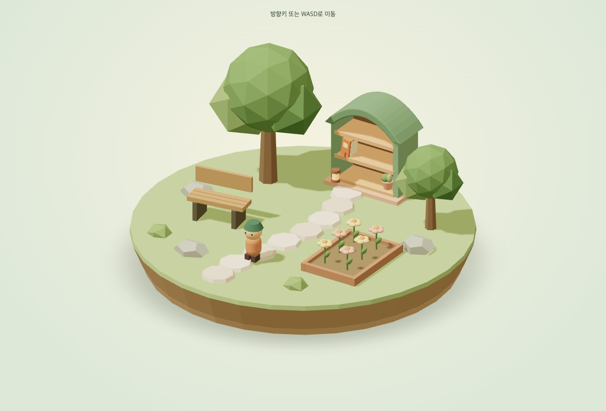
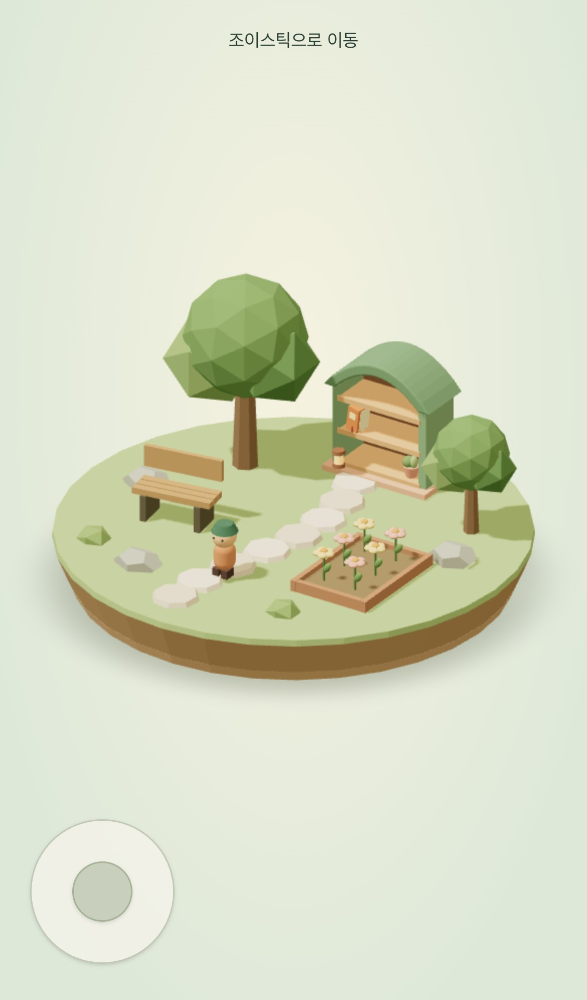
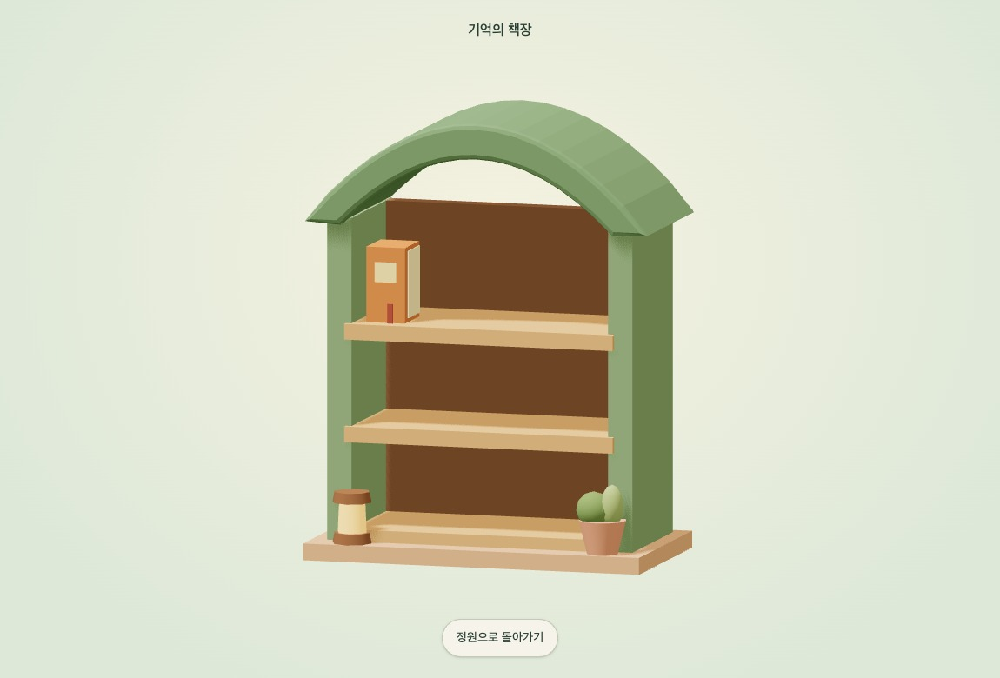
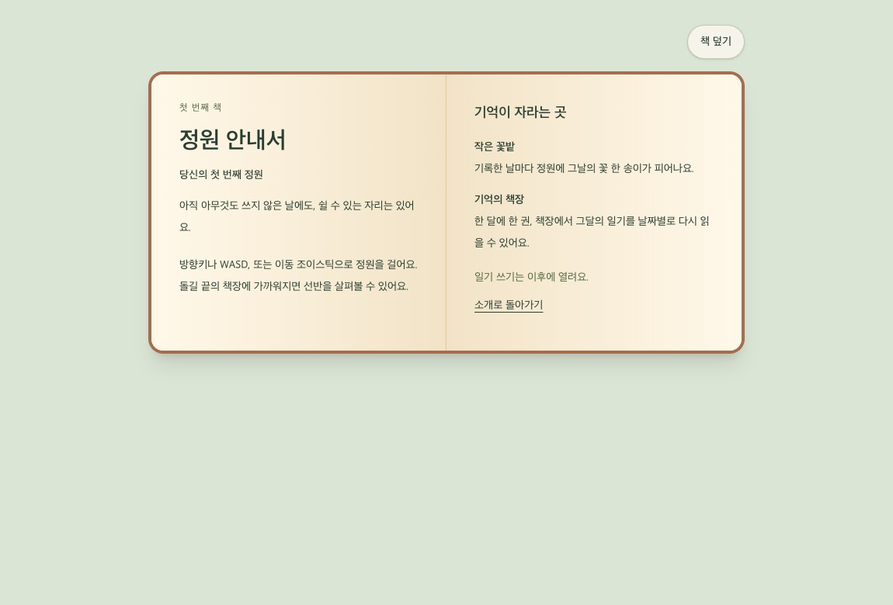

# 2026-11-05 프론트엔드 개발일지 — 걸어서 만나는 기억의 책장

기준 날짜는 2026년 11월 5일, Asia/Seoul이다. 지난 작업에서 고정 카메라로 정원을 보여 주던 화면을 시작점으로 삼았다. 이번 변경은 야외 정원에 캐릭터를 두고, 사용자가 돌길 끝까지 걸어가 책장을 살펴본 뒤 그 안의 안내서를 골라 읽는 흐름을 구현했다. 구현 기준 커밋은 `bb91d9e`이고, 변경은 [PR #12](https://github.com/Debuging-JunSeoPark/memory-garden/pull/12)와 [Issue #11](https://github.com/Debuging-JunSeoPark/memory-garden/issues/11)에 연결했다.

## 1. 무엇이 달라졌나

| 영역 | 작업 전 | 작업 후 |
| --- | --- | --- |
| 정원 화면 | 제목, 장소 소개, 정원 미리보기가 각 영역을 차지함 | 화면 전체에 정원을 배치하고 소개는 안내서에서 읽음 |
| 이동 | 장면을 바라보는 정적 미리보기 | 기본 캐릭터로 WASD·방향키 또는 터치 조이스틱을 사용해 이동 |
| 책장 | 정원 소품을 새로 디자인하는 단계 | 돌길 끝의 책장에 가까이 간 뒤 직접 클릭·터치하거나 Enter로 3D 선반을 열 수 있음 |
| 안내서 | 작업 중 접이식 영역과 모달을 거침 | 선반에서 안내서를 고르면 종이 두 면을 펼친 형태로 읽고, 덮으면 다시 선반으로 돌아감 |
| 대체 화면 | 수동 지도 전환과 WebGL 실패 시 자동 전환 | 평소 지도 버튼을 제거하고 WebGL 실패 시 자동 전환. 지도 속 책장을 통해 동일한 안내서에 도달 |
| 기록 성장 | 정원과 기록을 연결하는 제품 설계 | 월별 책과 일별 꽃의 규칙을 정리하고, 화면에는 안내서 한 권과 미리보기 꽃을 표시 |

## 2. 장면이 먼저 보이도록 화면을 다시 구성했다

첫 정원은 제목과 소개 글, 장소 목록을 읽고 나서 장면을 보는 구성으로 만들었다. 이번에는 사용자가 페이지에 들어오는 순간 정원이 먼저 보이기를 원했다. 그래서 화면에서 상단 제목, 옆 소개 영역, 푸터를 걷어내고 정원 캔버스에 뷰포트 높이를 배정했다. 소개를 없애는 대신 안내서에 넣어, 공간을 먼저 둘러본 사람이 필요할 때 읽게 했다. 접근 가능한 페이지 제목은 화면 읽기용으로 남겼다.

초기에는 하단에 안내서와 지도 버튼을 두고 사용자가 바로 열 수 있게 했다. 버튼을 상시 노출하면 발견하기는 쉽지만, 책장이 화면 장식처럼 보이고 사용자가 굳이 그곳까지 걸어갈 이유가 약해졌다. 최종 화면에서는 첫 이동 전의 짧은 조작 힌트, 터치 환경의 조이스틱, 책장 근처의 짧은 안내를 사용한다. 책장과 안내서를 여는 행위 자체는 정원과 선반 안에서 일어난다.

[GardenPreview](../../src/widgets/garden-preview/ui/garden-preview.tsx)는 페이지 제목과 안내서 내용을 조합한다. [GardenViewport](../../src/widgets/garden-preview/ui/garden-viewport.tsx)는 보기 상태와 WebGL 대체 경로를 관리한다. Three.js 장면은 기존처럼 서버 렌더링을 끈 동적 import 뒤에 둔다. 안내서의 텍스트와 링크는 HTML로 제공한다.

## 3. 참고 이미지의 인상을 정원 가구로 옮겼다

참고 이미지에서 가져온 요소는 아치와 나무 선반의 깊이, 작은 소품의 배치, 세이지색과 따뜻한 나무색의 조합이다. 큰 실내 구조를 얹는 방향도 검토했지만, 이번 화면에서는 기존 나무와 꽃밭, 돌길을 주인공으로 유지하기 위해 정원 가구 크기의 책장을 선택했다. 돌길이 책장 앞에서 끝나도록 배치해 공간의 목적지도 만들었다.

책장은 곡선 단면을 돌출한 지붕, 직육면체 선반과 옆판으로 만들었다. 안내서 옆에는 앞으로 월별 책이 들어갈 자리를 비워 두고, 화분과 랜턴은 받침 앞쪽으로 옮겼다. 꽃은 하나의 덩어리 대신 꽃잎·꽃심·잎을 조합했고, 화단에는 나무 테두리를 둘렀다. 이번 장면은 외부 모델 파일이나 새 그래픽 의존성 없이 기존 Three.js 도형과 재질을 사용한다.

첫 시각 검수에서는 받침 옆면의 띠가 겹치는 부분이 거칠어 보였고, 책장 위쪽 화분이 지붕 뒤로 가려졌다. 받침은 겹친 띠에서 위아래 원기둥의 반지름이 맞닿는 구성으로 바꾸었다. 화분은 보이는 위치로 내린 뒤, 최종 선반 치수에 맞출 때는 책 자리 밖으로 다시 배치했다. 이 검수는 캡처에 드러난 외형을 다듬기 위한 것이었고 기기별 성능 비교는 수행하지 않았다.

## 4. 기본 캐릭터와 보행 규칙

캐릭터는 머리, 모자, 몸통, 신발을 기본 도형으로 구성한 한 명으로 시작한다. 정원을 걷고 목적지에 도달하는 동작부터 검증할 수 있고, 이후 외형 해금을 연결할 때 저장 방식과 모델 교체를 별도로 설계할 수 있다. 지금 장면에는 외형 선택이나 레벨 해금 UI가 없다.

- 화면 오른쪽과 위쪽이 고정 카메라의 수평 축과 맞도록 입력을 월드의 X·Z 이동량으로 변환했다. 대각선 입력의 길이는 제한하고, 낮은 프레임률에서 한 프레임에 너무 멀리 뛰지 않도록 이동 계산에 쓰는 델타를 최대 0.05초로 제한했다.
- 섬 바깥은 반경 2.98의 보행 경계로 막는다. 나무 줄기는 원, 책장·벤치·화단은 축에 맞춘 직사각형 경계로 막고 X와 Z를 차례로 검사해 한 축이 막힐 때 다른 축으로 이동할 수 있게 했다. 돌길처럼 낮은 장식은 걸을 수 있는 표면으로 둔다.
- 플레이어 좌표는 장면 객체에서 갱신한다. React에는 첫 이동 여부와 책장 근처 여부처럼 UI에 필요한 변화를 전달한다. R3F의 demand 렌더링을 유지하며 입력이 들어오거나 이동 중일 때 다음 프레임을 요청한다.
- 키보드는 창 포커스를 잃거나 문서의 가시성이 바뀔 때 누른 키를 비운다. 모바일 조이스틱은 포인터를 잡아 손가락이 테두리를 벗어나도 방향을 계산하고, 손을 떼거나 입력이 취소되면 이동을 멈춘다.

리뷰에서는 반대 방향 키를 함께 눌러 움직임이 상쇄된 상태에서 한쪽 키를 떼도, 다음 프레임이 예약되지 않아 이동이 재개되지 않을 수 있다는 점이 나왔다. 키다운과 마찬가지로 키업에서도 실제로 누른 키 목록이 바뀌면 다음 프레임을 요청하도록 고쳤다. 화면에 보이지 않는 3D 장면만으로는 책장 도착을 알기 어려워 라이브 상태 문구도 추가했다.

[이동 계산과 경계](../../src/widgets/garden-preview/ui/garden-walk.ts) · [캐릭터와 입력 처리](../../src/widgets/garden-preview/ui/garden-player.tsx) · [조이스틱](../../src/widgets/garden-preview/ui/garden-joystick.tsx)

## 5. 책장과 책 읽기를 두 단계로 나눴다

캐릭터가 멀리 있을 때는 정원 속 책장을 눌러도 열리지 않는다. 책장 앞의 접근 범위에 들어오면 모델 클릭·터치나 Enter로 선반을 열 수 있다. 선반에 들어가면 같은 책장 모델을 가까운 직교 카메라로 보여 준다. **선반을 보는 상태와 안내서를 읽는 상태를 분리**해, 첫 책을 눌러야 본문으로 넘어간다. 책을 덮으면 선반이, 선반에서 돌아가면 원래 정원과 캐릭터 위치가 이어진다.

별도 버튼을 항상 놓는 방식, 클릭 한 번에 안내서를 여는 방식, 선반과 책을 차례대로 선택하는 방식을 단계별로 검토했다. 최종 선택은 빈 칸도 살펴볼 수 있고 이후 여러 월별 책 중 하나를 고를 수 있는 흐름이다. 3D 책 선택과 별도로 키보드로 초점을 받으면 나타나는 HTML 버튼을 둔다. 화면을 전환할 때 제목이나 닫기 버튼에 초점을 옮겨 다음 조작을 이어갈 수 있게 했다. 정적 제목에 생기던 화면 전체 폭의 기본 포커스 테두리는 제거했고, 실제 조작 버튼에는 포커스 표시를 남겼다.

### 선반의 치수와 책의 순서를 어떻게 정했나

처음에는 안내서를 보기 좋은 곳에 수동 배치하고 약간 기울였다. 이 배치는 책 한 권에는 자연스럽지만, 월마다 쌓이는 책을 일관된 간격으로 놓기 어렵다. 최종 모델은 **위에서 아래로 3단, 왼쪽에서 오른쪽으로 한 단에 5칸**으로 맞췄다. 책은 너비 0.19, 높이 0.36, 깊이 0.24의 공통 크기이며, 같은 줄의 책 중심 사이 거리는 0.24다. 책 바닥 높이는 각 선반 중심과 판 두께에서 계산한다.

번호 0은 최상단 왼쪽의 안내서가 차지한다. 이후 순번은 같은 줄에서 오른쪽으로 진행하고 다섯 번째 칸을 채운 뒤 아래로 이어진다. 가장 높은 줄의 가장자리까지 책을 놓을 수 있게 아치의 시작 높이를 올렸다. 현재 모델은 안내서 한 권만 그리며, 월별 책 데이터가 들어오는 시점에 빈 칸을 사용한다. 15칸을 넘었을 때의 화면 구성은 월별 기록 연결 단계에서 결정할 항목이다.

## 6. 모달 대신 읽을 수 있는 펼친 책

중간 단계의 모달은 텍스트를 빠르게 열고 닫기에는 편했지만, 사용자가 3D 선반에서 종이책을 꺼내 읽는 감각은 약했다. 최종 화면은 안내서를 별도의 읽기 상태로 열고, 데스크톱에서는 두 면을 나란히 배치한다. 종이색과 가운데 책등의 명암으로 펼친 책처럼 보이게 했고, 폭이 좁으면 두 면을 세로로 읽도록 바꾼다. 본문을 HTML로 구성해 스크린 리더, 확대, 텍스트 선택, 링크 탐색을 제공한다. 안내서에는 이동 방법과 앞으로 기록이 책장·꽃밭에 남는 규칙을 담았다.

WebGL 초기화에 실패하거나 실행 중 컨텍스트가 끊기면 정적 지도에 있는 책장을 통해 책 목록과 안내서에 도달할 수 있다. 3D 책장을 살펴보던 중 컨텍스트가 끊긴 경우에도 현재 읽기 흐름을 유지할 수 있도록, 렌더러 가용성과 화면 상태를 따로 관리했다.

## 7. 검증과 발견한 문제

| 검증 | 결과와 범위 |
| --- | --- |
| `pnpm check` | 소스 포맷, lint, 타입, 기존 테스트 25개, 저장소 검증, 프로덕션 빌드 통과 |
| `pnpm test:e2e` | 데스크톱·모바일 Chromium 총 8개 통과. 캐릭터가 책장에 도달해 안내서를 여는 경로, WebGL 초기화 불가, 실제 WebGL 컨텍스트 손실, 홈 화면을 확인 |
| 실제 포인터 경로 추가 확인 | 데스크톱 클릭과 모바일 에뮬레이션 터치로 먼 위치의 클릭 무시, 가까운 위치의 선반 열기, 첫 책 선택 후 읽기 화면 열기를 각각 확인 |
| 원격 CI | 구현 기준 커밋 `bb91d9e`의 [Validate repository 실행](https://github.com/Debuging-JunSeoPark/memory-garden/actions/runs/41978348362) 성공 |

전체 화면 레이아웃을 확인하는 초기 브라우저 테스트는 Canvas가 DOM에 나타나자마자 높이를 읽었다. R3F가 크기를 적용하기 전 값을 읽어 데스크톱과 모바일에서 실패했다. 준비 상태가 전달된 뒤 높이 조건이 충족될 때까지 확인하도록 고쳐, 장면이 실제로 화면을 채우는 시점을 검증했다. 후속 이동·책장 테스트는 조이스틱에 모바일 터치 입력을 보내고 선반 열기와 책 펼치기를 별개로 확인하도록 바꾸었다.

시각 검수는 데스크톱과 모바일 에뮬레이션 기준이다. 실제 iOS Safari·Android 단말, 스크린 리더 실기기, GPU 성능과 장시간 사용은 이번 검증 범위에 포함되지 않았다.

## 8. 기록과 정원이 연결될 때 남은 결정

- **책장은 월별**이다. 그달의 첫 일기가 저장되면 책 한 권이 생기고, 같은 달의 다음 기록은 그 책 안에 날짜별로 추가된다.
- **꽃밭은 일별**이다. 기록한 날짜마다 꽃 한 송이가 생기며 같은 날짜를 수정하면 기존 기록을 갱신한다. 현재 장면의 꽃은 고정된 미리보기 소품이다.
- **정원의 차이는 성장 선택에서 생긴다.** 기록이 쌓이면 화단, 연못, 나무 그늘처럼 풍경을 바꾸는 요소를 사용자가 고르는 방향을 [제품 설계](../superpowers/specs/2026-11-02-memory-garden-design.md)에 반영했다. 성장 기준과 실제 선택지는 기록 저장을 연결할 때 정한다.
- **캐릭터는 기본 한 명부터 시작한다.** 기록과 성장에 따른 외형 해금은 후속 범위다. 현재는 기본 이동과 책장 이용이 구현되어 있다.
