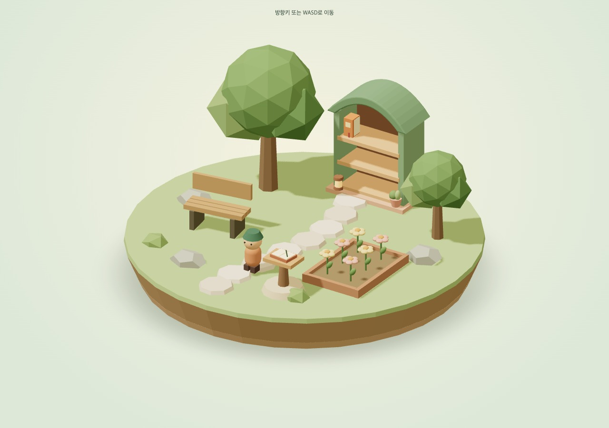
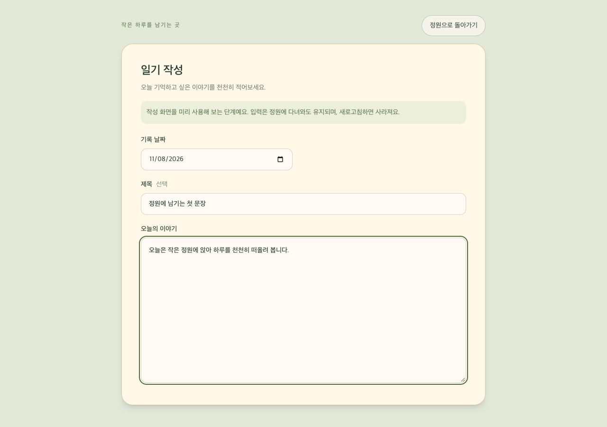
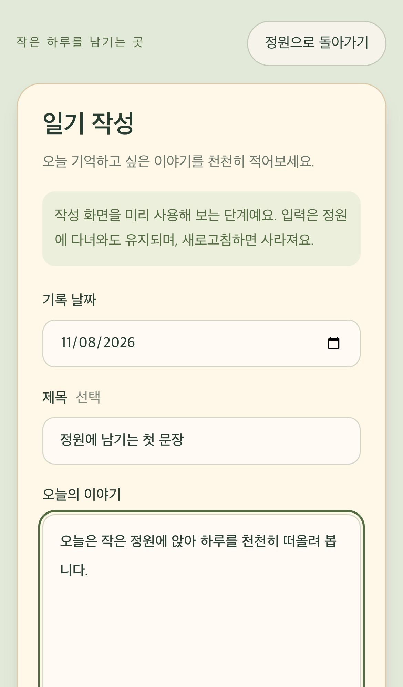
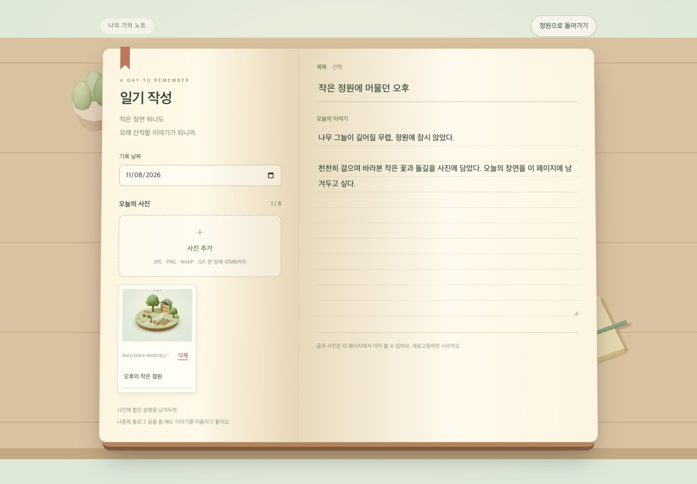
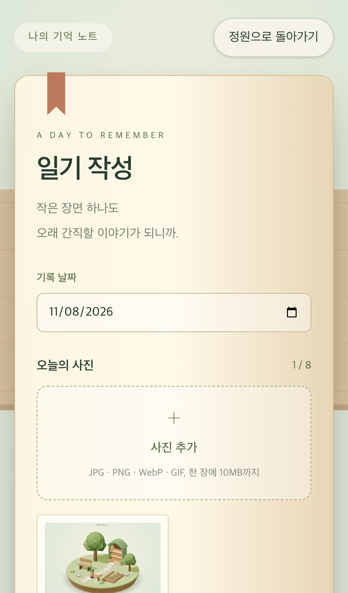

# 2026-11-08 프론트엔드 개발일지 — 일기 기능을 단계별 PR로 나누기

Asia/Seoul 기준으로 기록한다. 이번 단계는 기존 정원 구현을 통합하고 다음 일기 기능의 작업 경계를 정하는 일이다.

## 1단계 — 기존 정원 구현의 통합 준비

정원 이동과 책장 구현은 [PR #12](https://github.com/Debuging-JunSeoPark/memory-garden/pull/12)에 모여 있다. 정원에서 책장에 가까이 가서 선반을 열고, 최상단 왼쪽 안내서를 골라 읽는 기능이 구현되어 있다. 구현 상세와 화면 캡처는 [11월 5일 개발일지](2026-11-05-garden-walk-and-bookshelf.md)에 정리되어 있다.

진행 기록에는 이미 끝난 첫 정원 PR #9 병합이 진행 중으로 남아 있었다. 완료된 이동·책장·대체 화면과 다음에 구현할 일기 기능을 현재 기준으로 갱신했다. 병합 결과는 PR #12의 GitHub 상태와 main의 실제 커밋을 기준으로 확인한다.

최종 코드 리뷰에서는 이동 축, 조이스틱 입력 생명주기, 접근 범위, 선반과 책의 선택 단계, 최상단 책 배치, WebGL 실패 시 안내서 접근을 확인했고 Critical·Important 발견 사항은 없었다. 로컬에서 pnpm check와 pnpm test:e2e를 다시 실행해 단위 테스트 25개, 데스크톱·모바일 Chromium 8개와 프로덕션 빌드가 통과했다.

## 이후 PR의 범위

| 단계 | 구현 범위 | 사용자가 확인할 결과 |
| --- | --- | --- |
| 2 | 정원 속 작성 장소와 날짜·제목·본문 입력 화면 | 정원에서 작성 화면을 열고 내용을 입력 |
| 3 | 브라우저 저장과 다시 읽기·수정, 입력·실패 처리 | 저장한 일기를 새로고침 후 다시 열고 수정 |
| 4 | 기록 데이터와 월별 책·일별 꽃 연결 | 같은 달의 기록이 책 한 권에 모이고 기록 날짜마다 꽃이 생김 |

각 단계는 별도 브랜치와 PR로 진행하고, 단계 결과를 보고한 뒤 다음 작업으로 이어간다. 브라우저 저장으로 첫 작성·읽기 흐름을 완성하고, 계정과 기기 간 공유는 서버 저장을 연결할 때 다룬다. 각 PR에는 구현 이유, 실제 검증 결과, 다음 단계에서 이어갈 항목을 개발일지에 함께 기록한다.

## 2단계 — 정원 입구의 일기장과 작성 화면

[Issue #13](https://github.com/Debuging-JunSeoPark/memory-garden/issues/13)의 범위로 정원에 일기 작성 장소를 추가했다. 기존 책장에 월별 기록을 모으는 역할이 있으므로, 첫 입력 장소는 입구 오른쪽의 작은 나무 받침과 펼친 일기장으로 구성했다. 기본 캐릭터가 시작하는 자리에서 바로 접근할 수 있게 두어 첫 기록의 동선을 짧게 했다. 받침에는 충돌 범위를 적용하고, 가까운 위치에서 일기장을 클릭·터치하거나 Enter로 작성 화면을 연다.

### 작성 화면과 입력 상태

기록 날짜, 선택 제목, 본문을 각각 label과 연결했다. 종이색의 넓은 입력 영역을 사용하고 모바일에서는 작성 화면 내부를 스크롤할 수 있게 했다. 날짜는 첫 작성 화면을 열 때 브라우저의 현지 날짜를 만든다. UTC 날짜 문자열을 그대로 자르면 한국 시각 자정 근처에서 하루 전 날짜가 표시될 수 있어, 연·월·일을 현지 시간으로 읽어 조합한다.

입력 상태는 정원 위젯이 보관하고 작성 화면은 값과 변경 콜백을 받는다. 작성 화면을 닫으면 컴포넌트는 사라지지만 같은 페이지의 입력 상태는 남아 다시 열어 이어 쓸 수 있다. 새로고침하면 사라지는 범위를 화면 안내에 명시했다. 지속 저장과 저장 실패 처리는 3단계에서 붙일 예정이다.

### FSD 경계와 정원 이동

입력 UI와 날짜·제목·본문의 초안 구조는 features/write-diary에 두고 공개 index.ts로 가져온다. 정원 소품은 garden-preview 내부에 두어 Three.js 좌표와 모델이 입력 기능에 섞이지 않게 했다. 저장 서비스나 사용하지 않는 데이터 저장 인터페이스는 이 단계에서 추가하지 않았다.

화면을 작성 상태로 전환하면 캐릭터의 이동 리스너를 해제하고 누른 키를 비운다. WASD와 방향키를 입력 폼 안에서 사용할 수 있으며, 정원으로 돌아왔을 때 누르고 있던 방향으로 계속 움직이지 않게 한다. 정원 카메라와 캐릭터 객체는 유지하여 돌아왔을 때 원래 위치에서 이어간다. WebGL 대체 지도에도 일기장 표시와 키보드로 선택 가능한 진입점을 추가했다.

### 초점 복귀에서 발견한 문제

작성 화면은 스스로 제목에 초점을 옮긴다. 처음에는 상위 위젯에서 작성 상태의 초점 처리를 건너뛰면서 이전 화면을 기록하는 값도 갱신하지 않았다. 그러면 작성 화면을 닫을 때 화면 변화가 없었던 것으로 판단해 초점 복귀를 놓칠 수 있었다. 이전 화면 값은 모든 전환에서 갱신하고, 작성 화면의 최초 초점만 해당 기능이 담당하도록 정리했다. 지도에서 열었을 때는 지도 속 일기장 버튼으로, 3D에서 열었을 때는 정원으로 돌아가도록 했다.

### 검증과 범위

pnpm check에서 포맷·린트·타입·기존 단위 테스트 25개·저장소 검증·빌드를 통과했다. pnpm test:e2e는 기존 정원 8개에 작성 흐름 4개를 더해 데스크톱·모바일 Chromium 총 12개가 통과했다. 새 검사는 작성 진입, 같은 페이지의 입력 유지, 입력 중 이동 정지, 지도 접근을 확인한다. 한국 시간대에서 UTC 기준 11월 7일 15시 30분을 고정해 기본 날짜가 11월 8일이 되는지도 확인했다.

별도 화면 검수에서는 3D 일기장을 직접 클릭하거나 터치해 같은 작성 화면이 열리는지 확인했다. 데스크톱과 모바일 화면에 가로 넘침은 없었다. 실제 모바일 기기의 가상 키보드와 Safari 검증은 후속 확인 대상이다.

이 단계에서 입력한 내용은 페이지 메모리에 보관한다. 다음 PR에서 날짜별 저장·다시 읽기·수정과 실패 처리를 연결한 뒤, 그다음 PR에서 월별 책과 일별 꽃에 실제 기록을 연결한다.

## 2단계 보완 — 사진을 붙이는 입체적인 기억 노트

작성한 일기를 나중에 블로그 초안으로 엮을 때 사진도 함께 필요하다는 피드백을 반영했다. 작성 화면의 왼쪽 면에는 기록 날짜와 사진을, 오른쪽 면에는 제목과 줄이 있는 본문을 놓았다. 표지 두께, 책등의 명암, 책갈피와 원근을 더해 펼친 노트처럼 보이게 했다. 뒤에는 실제 Three.js 책상, 화분, 필기 소품을 렌더링한다. 기존 정원 Canvas의 장면과 카메라를 전환하므로 작성 화면에서도 Canvas는 하나를 사용한다. 입력 텍스트와 사진 조작은 HTML로 제공한다.

사진은 여러 장을 선택하고 미리 보기와 설명 입력, 삭제를 할 수 있다. 초안에 File과 설명을 함께 보관하므로 정원에 갔다가 다시 열어도 이어 볼 수 있다. 크기와 개수의 초기 기준은 한 장당 10MB, 최대 8장으로 정했다. JPG, PNG, WebP, GIF를 지원하고, MIME 검사 뒤 브라우저가 실제로 읽을 수 있는 이미지인지 확인한다. 지원하지 않는 파일, 읽을 수 없는 이미지, 용량과 개수 제한은 파일명과 함께 안내한다. 이 단계의 사진 선택은 브라우저 메모리에만 남고, 서버 전송과 지속 저장은 후속 저장 단계에서 연결한다.

미리보기는 임시 object URL을 사용한다. 검사용 URL은 성공과 실패 모두에서 해제하고, 썸네일 URL은 해당 이미지가 제거되거나 페이지가 끝날 때 해제한다. 사진을 읽는 중에 사용자가 본문을 수정해도 이전 입력으로 덮이지 않게, 초안 변경 콜백을 최신 상태를 받는 함수 형태로 바꾸었다.

리뷰에서는 사진을 읽는 중에 화면을 닫고 다시 열면 처리 중 표시가 초기화되어 다음 선택과 겹칠 수 있다는 문제를 발견했다. 일부 사진이 개수 제한에 걸려 조용히 누락되는 경로가 될 수 있었다. 이 경로를 이미지 해독 대기를 제어하는 브라우저 테스트로 재현했다. 작성 화면을 첫 진입 후 유지하고 닫을 때 숨기는 방식으로 바꿔, 읽기 작업과 중복 선택 방지가 정원 방문 중에도 이어지게 했다. 화면을 다시 열 때는 제목으로 초점을 옮긴다.

전체 검사와 데스크톱·모바일 Chromium 18개가 통과했다. 새 사진 시나리오는 추가·설명·삭제·재선택, 개수와 용량 제한, 손상된 이미지, 텍스트 유지, 사진을 읽는 도중의 화면 왕복을 다룬다. 모바일에서는 노트 두 면을 세로로 읽으며 화면 내부를 스크롤한다. 정적 지도에서도 동일한 입력과 사진 조작을 사용할 수 있고, 3D가 가능하면 책상 배경을 함께 보여 준다.

