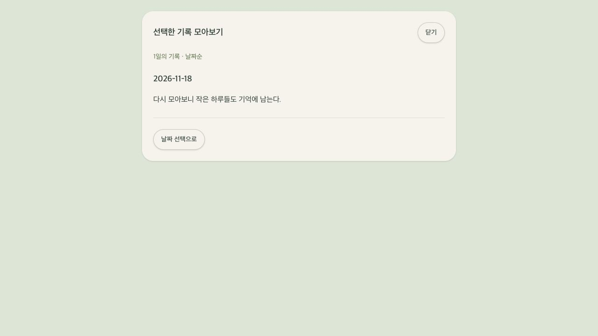

# 2026-11-18 프론트엔드 개발일지 — 업데이트 통합과 여러 날의 기억 모아보기

오늘은 누적된 업데이트 PR 여섯 개를 병합하고, 월별 책에서 여러 날짜를 선택해 기록을 날짜순으로 읽는 기능을 구현했다. 기능 작업은 [Issue #29](https://github.com/Debuging-JunSeoPark/memory-garden/issues/29)에서 추적한다.

## 누적 PR 통합

| PR | 반영 내용 | 병합 커밋 |
| --- | --- | --- |
| #16 | 실패 시 결과물을 보관하는 upload-artifact v7 | c8f815a |
| #28 | Next.js 16.4.6, Playwright 1.65.0, Tailwind와 포맷 도구 패치 | 614234f |
| #19 | lint-staged 17, Node 실행 환경 정합성 | 430a5e9 |
| #21 | commitlint CLI 21 | 6a6cec4 |
| #18 | commitlint conventional 설정 21 | 8f0c21f |
| #20 | Node 26 타입 | f99031c |

각 PR의 변경 파일과 CI를 확인했다. lint-staged 17.6.0은 Node 22.22.1 이상을, commitlint CLI 21.2.4는 Node 22.12.0 이상을 요구했다. 기존 .nvmrc의 Node 20과 맞지 않아 Node 타입 업데이트의 주 버전과 같은 Node 26을 선택했다. .nvmrc, package.json의 엔진 범위, README의 실행 안내를 함께 변경했다. 로컬 검증 명령도 Node 26으로 실행했다.

패키지 PR들은 package.json과 lockfile의 인접한 부분을 수정해 순차 병합 중 충돌이 생겼다. 이미 병합한 버전을 유지한 package.json을 기준으로 해당 업데이트를 적용하고 pnpm으로 lockfile을 다시 생성했다. Dependabot이 원격 브랜치를 자동 갱신한 경우에는 새 이력에서 이어갔으며, 강제 푸시를 사용하지 않았다. 충돌 해결 후 각 PR의 최신 필수 검사를 통과시킨 뒤 Squash 병합했다. 여섯 개를 마친 시점에 열린 PR 0개를 GitHub 화면에서 확인했다.

## 월별 책에서 기록 고르기

기존 월별 책은 날짜 목록과 하루씩 읽는 흐름을 제공했다. 각 날짜에 체크박스를 추가하고 선택 개수와 진행 버튼을 목록 위에 배치했다. 선택이 없을 때 모아보기 버튼을 비활성화한다. 제품 설계의 기록 선택 기준을 따라 최대 14일을 허용하고, 상한에 도달하면 선택하지 않은 날짜만 비활성화해 기존 선택은 해제할 수 있게 했다.

모아보기에서는 선택 순서와 관계없이 날짜가 이른 기록부터 보여 준다. 각 날짜 아래에 저장된 제목·본문·사진·사진 설명을 기존 DiaryMemory로 표시한다. 읽기 실패는 해당 날짜에서 재시도할 수 있어 다른 날짜의 내용과 함께 확인할 수 있다.

선택 상태와 모아보기 여부는 기존 월별 책의 화면 상태와 함께 정원 위젯에 둔다. 새 저장소를 추가하지 않고 현재 열고 있는 책 안에서 선택을 유지한다. 날짜 선택 화면으로 돌아오거나 개별 기록을 읽고 목록으로 돌아와도 선택이 남는다. 다른 책을 열 때는 선택을 초기화한다. 모아보기와 선택 화면을 전환하면 제목에 초점을 옮겨 키보드 사용자가 화면 변화를 따라갈 수 있게 했다.

## 설계 선택

| 고민 | 선택한 방식과 이유 |
| --- | --- |
| 기록 순서 | 날짜 문자열을 정렬해 시간순으로 읽는다. 선택한 순서대로 나열하면 뒤섞인 회고가 될 수 있다. |
| 입력 내용과 읽기 | 저장된 DiaryMemory를 재사용해 기존 글·사진 표시와 읽기 실패 처리를 이어간다. |
| 선택의 수명 | 현재 열린 책 안에서 유지한다. 날짜 선택 화면으로 돌아와 선택을 조정하는 흐름을 지원한다. |
| 읽기 실패 범위 | 실패한 날짜에서 다시 불러온다. 모아본 다른 날짜도 계속 읽을 수 있다. |

## 검증과 시행착오

새 브라우저 시나리오는 같은 달의 15일 기록을 준비해 0일 선택, 14일 상한, 선택 해제, 날짜순 내용, 사진 실제 해독, 설명 표시, 읽기 실패 재시도, 복귀 후 선택 유지를 확인한다. 시험 데이터는 검수용 글과 1픽셀 이미지다.

첫 데스크톱 실행에서는 테스트가 날짜 제목뿐 아니라 일기 제목도 함께 선택해 실패했다. 날짜 이름을 가진 heading으로 대상을 좁힌 뒤 데스크톱·모바일에서 다시 검증했다. 코드 리뷰에서도 날짜 선택·모아보기의 상태와 접근성에 중요한 문제가 발견되지 않았다.

최종 의존성 조합에서 pnpm install --frozen-lockfile, pnpm check, pnpm test:e2e가 모두 통과했다. Node 테스트는 25개, 데스크톱·모바일 Chromium 브라우저 테스트는 28개다.

