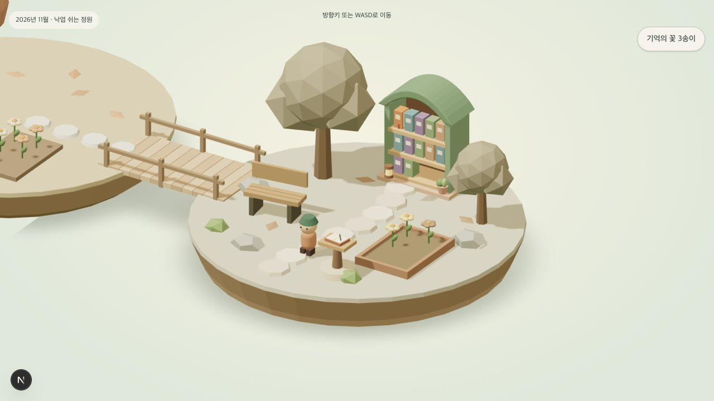
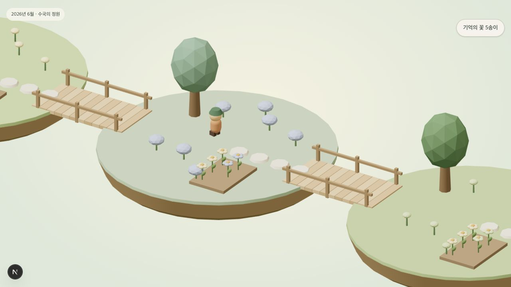
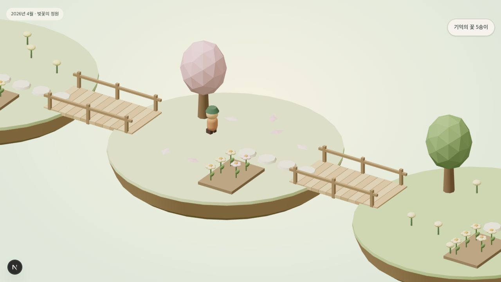
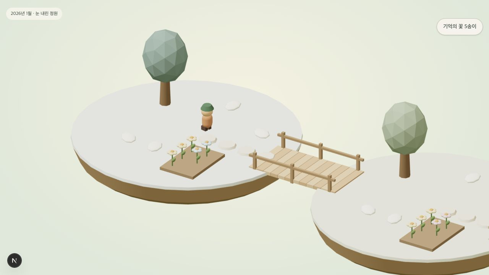

# 2026-11-18 프론트엔드 개발일지 — 1월부터 11월까지의 계절 산책길

> 11월 19일 사용자 요청으로 세 땅씩 묶는 배치로 변경했다. 최종 배치와 검증은 [세 칸 정원 후속 일지](2026-11-19-three-column-gardens.md)에 기록한다.

## 목표가 구체화된 지점

두 땅 보행 시제품을 만든 뒤 사용자가 “지금이 11월이니 1월부터 11월까지 월에 맞는 테마의 땅을 만들고 각각 더미 데이터를 넣어 실제로 사용하고 싶다”고 요청했다. 이에 [PR #32](https://github.com/Debuging-JunSeoPark/memory-garden/pull/32)의 최종 범위를 올해 1월부터 현재 월까지의 정원으로 변경했다. 두 달 시제품과 별개의 미완료 PR을 늘리지 않고 같은 작업을 갱신한다. [Issue #31](https://github.com/Debuging-JunSeoPark/memory-garden/issues/31)과 [설계 문서](../superpowers/specs/2026-11-18-seasonal-monthly-gardens-design.md)로 추적한다.

이전 [두 달 시제품 일지](2026-11-18-two-month-garden.md)는 다리와 카메라를 처음 만든 과정의 기록이다. 다음 월을 미리 열던 규칙과 두 번째 땅이 비어 있다는 설명은 이번 변경으로 대체된다.

## 월별 땅을 배치한 방식

올해 1월부터 현재 월까지만 배열을 만든다. 2026년 11월 18일에는 11개이며 12월 땅은 없다. 키는 표시 문구와 분리한 `2026-01` 같은 연월 문자열이다. 현재 월은 기존 원점 x = 0에 두고 과거 월은 8 단위씩 왼쪽에 배치한다. 11월에서 출발해 왼쪽으로 걸으면 10월·9월을 거쳐 1월에 도착한다. 1월의 x는 -80이다.

한 줄 산책길과 격자 배치를 검토했다. 격자는 더 작은 지도에 많은 땅을 넣을 수 있지만, 세로 다리와 모서리 충돌, z 방향 추적과 이동 축을 한 번에 바꿔야 한다. 이번에는 이미 왕복을 검증한 가로 다리와 카메라를 일반화하는 한 줄 방식을 개발자 판단으로 선택했다. 이동 거리가 길다는 비용은 남지만 월 순서가 분명하고 경계의 오류를 줄일 수 있다.

현재 월의 기존 책장·일기장·벤치는 그대로 둔다. 과거 월에는 나무·징검돌·계절 장식·그 월의 기억 꽃밭을 배치한다. 과거 월까지 책장과 작성 장소를 복제하지 않았다. 기존 책장은 다른 연도를 포함해 저장된 모든 월의 책을 보여 준다.

## 계절을 구분한 요소

| 월 | 테마 | 풍경의 차이 |
| --- | --- | --- |
| 1월 | 눈 내린 정원 | 밝은 눈빛 지면, 청록빛 나무, 작은 눈 더미 |
| 2월 | 겨울 끝의 정원 | 옅어진 눈빛과 부드러운 회녹색 나무 |
| 3월 | 새싹의 정원 | 연두색 지면, 어린 초록 잎과 작은 꽃 |
| 4월 | 벚꽃의 정원 | 분홍빛 수관, 흩어진 꽃잎 |
| 5월 | 풀꽃의 정원 | 초록 잔디와 따뜻한 풀꽃 |
| 6월 | 수국의 정원 | 청록빛 지면과 푸른 수국 덩어리 |
| 7월 | 초록 그늘 정원 | 짙은 녹색 수관과 밝은 초록 풀꽃 |
| 8월 | 한여름 햇살 정원 | 노란 꽃과 짙은 중심, 햇빛을 받은 잔디색 |
| 9월 | 가을 문턱의 정원 | 노랑이 섞인 잎과 떨어진 작은 잎 |
| 10월 | 단풍의 정원 | 주황빛 수관과 따뜻한 단풍색 |
| 11월 | 낙엽 쉬는 정원 | 차분한 베이지 잔디와 갈색 낙엽 |

색만 바꾸지 않도록 겨울에는 납작한 눈 더미, 봄에는 바닥 꽃잎, 여름에는 줄기와 꽃 덩어리, 가을에는 잎 모양의 작은 입체물을 둔다. 코드 기반 저해상도 모델과 무광 재질을 유지했다. 텍스처나 외부 모델 다운로드를 추가하지 않았다. 12월 테마 설정도 다음 달 진입에 사용할 수 있지만 현재 월 이전이라는 생성 조건 때문에 지금 장면에는 나타나지 않는다.

## 월별 기록과 꽃의 연결

기존 꽃 목록은 모든 날짜를 합친 배열이었다. 3D 정원에서는 현재 캐릭터가 도착한 땅의 연월 키와 일치하는 날짜만 찾아 꽃과 개수를 표시한다. 11월에는 11월의 기록 세 개, 과거의 예시 월에는 각 다섯 개가 보인다. 활성 월에서 여섯 개를 넘으면 기존 페이지 이동을 유지한다. 옆 땅의 꽃은 해당 월의 첫 여섯 날짜를 표시한다.

옆 땅의 꽃을 눌러도 정확한 기록이 열리도록 클릭한 날짜에서 연월 키를 구해 읽기 목록을 연다. 캐릭터가 있는 월을 무조건 사용하는 대신 기록 자신의 날짜를 따른다. 월이 바뀔 때 꽃 페이지는 첫 페이지로 초기화한다. 같은 날짜 수정으로 꽃이 추가되는 동작은 만들지 않았다.

WebGL을 사용할 수 없을 때의 기존 정적 지도는 모든 기록의 페이지 조회를 유지했다. 과거 연도 기록도 계속 접근할 수 있다. 이번에 정적 지도를 열한 땅으로 다시 모델링하거나 월별 테마 이동 UI를 추가하지 않았다.

## 보행과 렌더링을 분리한 이유

지면 검사와 충돌은 열린 전체 땅 배열을 받는다. 각 원형 지면 사이에 같은 규격의 다리를 추가하고, 모든 다리 양쪽의 난간을 캐릭터 반경까지 고려해 막는다. 다리에서는 이전 월을 유지하고 다음 땅의 입구를 넘었을 때 월을 바꾼다. 기존 두 땅 테스트도 두 월의 고정 fixture로 바꿔 일반화한 구현을 계속 검증한다.

과거 월의 꽃밭은 중심선을 막지 않는 local x = 1.1, z = 1.4에 뒀다. 나무도 중심선에서 떨어뜨렸다. 1월까지 직선으로 걸을 수 있고 꽃밭과 나무는 통과하지 않는다. 실제 검수에서는 기존 키보드의 화면 방향에 맞춰 왼쪽과 왼쪽 위 입력을 조합하며 열한 달을 걸었다.

열한 땅의 모든 메시와 꽃을 동시에 렌더링하면 특히 소프트웨어 WebGL이나 모바일에서 비용이 커진다. 물리 지면은 모두 유지하되 화면 장면은 현재 월과 양옆 월까지만 렌더링한다. 월이 바뀔 때 다음 이웃을 추가한다. 경계에서 건너는 다리가 사라지지 않도록 양쪽 연결을 포함한다. 기존 ref 위치 공유와 demand 렌더링, 카메라 수평 추적을 유지했다. 새 전역 상태 저장소는 추가하지 않았다.

## 더미 데이터 준비와 기존 기록 보존

개발용 `/demo`의 생성 범위를 직전 여섯 달에서 올해 1월부터 오늘까지로 변경했다. 각 월의 1일·7일·14일·21일·말일을 선택하고, 현재 월에서 오늘 이후의 날짜는 뺀다. 11월 18일 기준 1~10월 각 다섯 개와 11월 1일·7일·14일 세 개, 총 53개다. 윤년의 2월 29일도 Date의 말일 계산을 따른다.

본문은 월별 날씨와 풍경을 반영한 여러 문단의 가상 일기다. 제목에는 `[예시]`, 본문에는 가상 일기임을 표시했다. 사진은 추가하지 않았다. 실제 사진이나 개인 일기는 기억 파일·캡처에 사용하지 않았다.

기존 `addDiarySamples`의 단일 readwrite 트랜잭션과 키 존재 검사, 빈 날짜만 add하는 규칙을 재사용했다. 현재 브라우저에는 이전 예시 30개가 있었으므로 새로 23개가 추가됐다. 두 번째 실행에서는 0개였다. 이미 존재하던 예시 본문도 새 계절 본문으로 덮어쓰지 않았다. 1월 땅까지 걸어간 뒤 1월 1일의 새 예시 본문을 읽었고, 마지막에는 화면을 11월로 다시 열어 두었다.

## 검증과 CI 문제

`pnpm check`에서 포맷·린트·타입·단위 테스트 33개·저장소 검증·프로덕션 빌드를 통과했다. 단위 검사는 11월에 11개 땅 생성, 1월 경계, 미래 월 제외, 전체 길 중심선 왕복, 모든 난간 입구 충돌, 다리 위 월 유지, 월별 더미 분포와 미래 날짜 제외를 다룬다.

브라우저 검사는 10월 기록 두 개와 11월 기록 하나를 실제 작성 화면에서 저장한다. 11월 꽃 하나를 확인하고 키보드/터치로 10월에 도착하면 꽃 두 개가 보이는지, 10월 본문을 읽는지, 다시 11월로 오면 꽃 하나로 돌아오는지 확인한다. 날짜는 2026년 11월 18일로 고정해 실행일에 따라 검사가 바뀌지 않게 했다. 데스크톱·모바일의 이 시나리오 두 개가 통과했다.

앞선 두 달 시제품 PR의 원격 CI는 데스크톱 보행 두 건이 시간 안에 끝나지 않았다. 로그에서 책장 도착은 5초 제한, 다리 왕복은 테스트 전체 30초 제한과 충돌했다. 소프트웨어 렌더러의 낮은 프레임률과 프레임 간 이동량 상한 때문에 실제 이동 시간이 늘어날 수 있다. CI worker를 하나로 제한해 동시에 여러 3D 장면이 경쟁하지 않게 하고, 보행은 상태 변화로 기다리되 개별 도착 최대 25초·전체 65초로 분리했다. 이 제한은 이동을 생략하거나 검사를 건너뛰지 않는다.

로컬 CI 모드의 첫 전체 실행에서는 모바일 사진 미리보기 검사가 처음 5초 안에 완료되지 않았고 재시도에서는 통과했다. 보행 검사는 통과했다. 반복 확인 결과, setInputFiles가 초안 조회 중 비활성화된 fieldset에 파일을 넣을 수 있어 일기 초기화와 경합하는 검사 문제였다. 파일 입력이 활성화된 것을 기다린 뒤 업로드하도록 바꾸었고, 후속 세 칸 정원의 CI 모드 전체 E2E 30개가 재시도 없이 통과했다. 독립 코드 리뷰에서는 중요한 결함을 발견하지 않았다.

## 화면 확인

## 후속 작업과 남은 한계

- 원점의 그림자 범위가 유지되어 과거 월의 나무와 캐릭터에는 현재 월과 같은 수준의 접촉 그림자가 없다. 독립 리뷰의 경미한 시각 개선 항목으로 남겼다.
- 카메라 보간의 모션 감소 설정 대응과 월 중앙까지 캐릭터를 자동 판별하는 시각 검사는 이전 일지의 후속 항목을 유지한다.
- 열린 월은 정원에 들어올 때 현지 달력으로 계산한다. 정원을 연 채로 월이 바뀌는 순간의 재계산, 계정별 개방 이력과 이전 연도 땅 보관은 별도 설계가 필요하다.
- 예시 추가는 개발 서버에서만 제공한다. 실서비스에 자동으로 가상 기록을 넣지 않는다.
