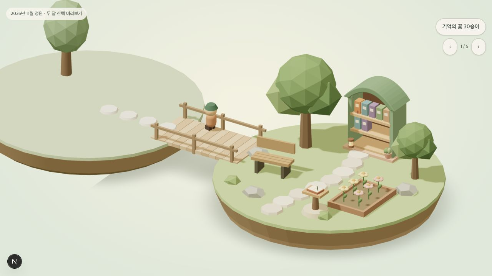
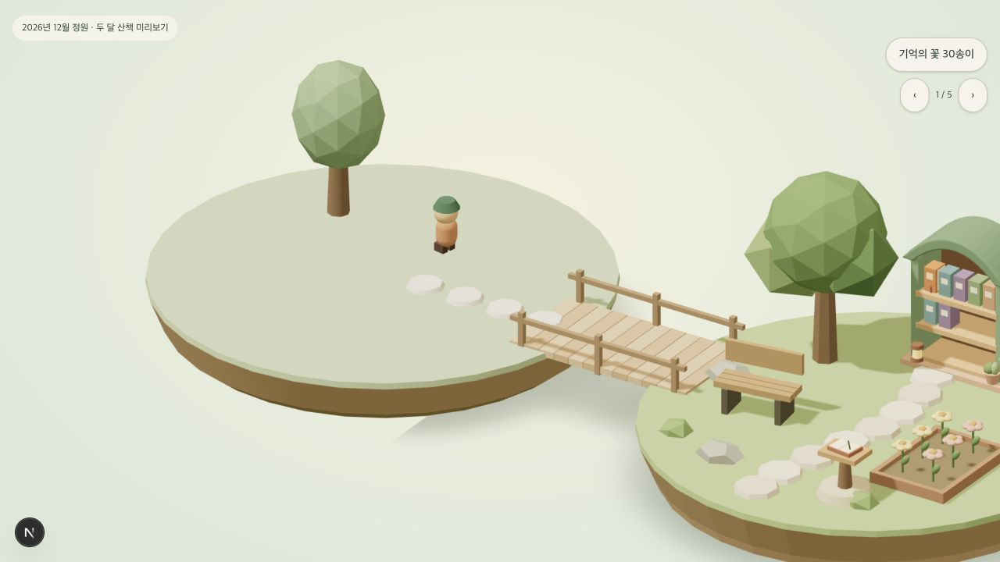
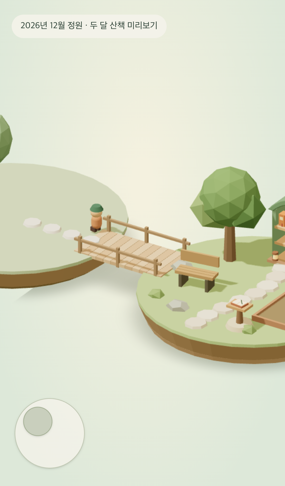

# 2026-11-18 프론트엔드 개발일지 — 월별 땅 확장의 첫 보행 시제품

## 이번에 바꾸려는 경험

사용자가 한 땅에 모든 기록이 쌓이는 정원을 월별 공간으로 바꾸기를 요청했다. 최종 방향은 한 번에 12개를 보여 주는 것이 아니라 새 월이 시작될 때 땅이 늘어나고, 각 월의 일기를 쓸수록 그 땅이 꾸며지며, 계절에 맞는 풍경 사이를 직접 걸어 다니는 것이다. 책장은 월별 기록을 읽는 장소로 유지한다.

기존 제품 설계의 작은 정원·캐릭터 이동·기록과 풍경의 연결을 바탕으로 하되, 먼저 두 땅의 이동 경험부터 확인하는 단계로 나눴다. 이번 작업은 [Issue #31](https://github.com/Debuging-JunSeoPark/memory-garden/issues/31)에서 추적한다. 이전 날짜 모아보기 [PR #30](https://github.com/Debuging-JunSeoPark/memory-garden/pull/30)은 필수 CI 성공과 충돌 없음을 확인한 후 Squash 병합했다. 통합 커밋은 `6ec0b51`이다.

## 첫 PR에 포함한 것과 후속 작업

| 구분 | 이번 동작 |
| --- | --- |
| 두 월의 땅 | 기존 정원을 원점에 두고 새 땅을 x = -8에 둔다. 브라우저 현지 날짜의 현재 월과 다음 월을 표시한다. |
| 연결 길 | 두 땅 사이에 판자와 양쪽 난간을 가진 짧은 나무다리를 둔다. 화면을 바꾸거나 순간 이동하지 않는다. |
| 이동 | 기존 방향키·WASD·모바일 조이스틱으로 왕복한다. 책장·일기장 접근 기능을 유지한다. |
| 카메라 | 기존 직교 투영과 바라보는 방향을 유지하면서 캐릭터의 x 이동을 따라간다. |
| 월 표시 | 다리 위에서는 출발한 월을 유지하고 반대쪽 땅에 도착하면 바꾼다. |

이 시제품에서는 다음 월 땅도 항상 열어 둔다. 실제 새 월 개방, 최대 12개 배치, 연도 전환 정책, 월별 꽃 분리, 계절 재질과 성장 장식은 아직 구현하지 않았다. 기존 일기는 기존 땅의 꽃과 책장에서 그대로 읽는다. 두 번째 땅은 이동을 확인하기 위한 빈 땅이다. 정적 지도도 기존 기록 접근 기능을 유지하며 두 땅 산책은 3D 장면에서 제공한다.

## 공간과 충돌 설계

### 장면 전체를 복제하지 않은 이유

기존 GardenIsland에는 책장, 작성 장소, 꽃, 벤치와 나무가 함께 들어 있다. 이를 그대로 두 번 배치하면 작성 장소와 기록 열기 기능도 두 벌 생긴다. 어느 월의 기록을 여는지 정하지 않은 상태에서 그런 동작을 만들지 않도록, 이번에는 두 번째 땅의 지형·나무·징검돌만 별도 컴포넌트로 만들었다. 월별 기록을 연결하는 단계에서 공통 지형과 월별 소품을 다시 정리할 수 있다.

새 지형은 기존과 같은 반경 3.25의 낮은 원형 땅, 흙 단면과 잔디 색을 사용한다. 두 번째 땅에도 하부 흙 층을 추가해 기존 땅과 두께가 다르게 보이지 않게 했다. 두 땅 사이의 중심 간격은 8이므로 지형 가장자리 사이에 약 1.5의 틈이 생긴다. 다리는 이 틈보다 길게 만들어 양쪽 땅에 걸친다.

### 물리 엔진 대신 기존 보행 판정을 확장

기존 이동은 다음 위치가 허용되는지 검사하고 x와 z를 각각 갱신하는 방식이다. 두 원형 영역과 다리의 직사각형 영역의 합집합을 지면으로 사용했다. 보행 원의 반경은 기존 2.98을 유지해 캐릭터 중심이 보이는 땅 끝까지 나가지 않게 했다. 다리의 통과 영역은 x = -5.25부터 -2.75까지, 중심선에서 z 방향으로 ±0.54다.

기존 나무·책장·벤치·작성 장소의 장애물 판정은 유지하고 두 번째 나무의 충돌을 추가했다. 지면과 장애물은 별개다. 캐릭터가 다리 근처 땅 위에 있다고 해서 난간을 통과할 수 있는 것은 아니므로 난간도 독립적인 직사각형 장애물로 검사한다.

난간은 z = ±0.73, 길이 2.85, 두께 0.07이다. 캐릭터 반경 0.15를 난간의 양쪽 끝과 두께에 더해 중심점의 충돌 영역을 계산했다. 캐릭터 반경과 난간 치수는 모델과 충돌이 같은 값을 가져가도록 좌표 모듈에 뒀다. 다리 중심에서 멀리 떨어진 땅 위에서는 난간 끝을 돌아갈 수 있다.

## 카메라와 React 상태의 선택

두 땅을 한 화면에 항상 넣으면 특히 모바일에서 캐릭터와 책장이 너무 작아진다. 기존 정원을 보던 배율을 유지하고 카메라가 수평으로 따라오는 방식을 선택했다. 이동할 때 카메라 위치와 주시점을 같은 x만큼 옮기므로 카메라 방향이 바뀌지 않는다. 화면 방향을 기준으로 계산하던 기존 이동 축도 유지된다.

처음 정원에서 조금 걷는 동안에는 카메라가 움직이지 않게 여유를 두었다. 목표 x는 `min(0, 캐릭터 x + 1.5)`이며 이후 감쇠 보간으로 따라간다. 캐릭터 위치는 매 프레임 React 상태로 올리지 않고 ref로 공유한다. 월 영역이 바뀔 때만 DOM 표시용 상태를 갱신한다.

Canvas는 기존 demand 렌더링을 유지한다. 캐릭터가 이동하는 프레임과 카메라가 목표 위치에 아직 도착하지 않은 프레임만 다음 프레임을 요청한다. 카메라와 목표의 차이가 0.002 이내가 되면 추가 갱신을 멈춘다. 책장과 작성 화면에서는 기존 전용 카메라 위치를 사용하고 추적을 중단한다.

새 월 안내와 기존 조작 안내가 모바일 상단에서 겹칠 수 있어 좁은 화면의 조작 안내는 조이스틱 위쪽으로 옮겼다. 데스크톱에서는 기존 상단 중앙 배치를 유지한다. 월 이름에는 polite live 영역을 사용하고 기존 상호작용 안내 status는 하나로 유지했다.

## 발견한 문제와 수정 근거

### 이동 테스트가 다리 중간에서 끝난 문제

처음 브라우저 테스트는 월 이름이 5초 안에 바뀌기를 기다렸다. 여러 Chromium 검사를 함께 실행했을 때 데스크톱에서 시간이 부족했다. 실패 trace의 화면에는 캐릭터가 다리 중간까지 이동해 있었다. 이동 단위 테스트는 통과했고 직접 키보드 왕복도 가능했다. 이 근거를 바탕으로 고정 시간에 이동이 끝날 것이라는 가정을 없애고 월 표시 변화라는 도착 조건을 최대 15초까지 기다리게 했다. 시작 위치에서 벤치를 피하는 첫 입력 구간만 짧은 키 유지 시간을 사용한다.

동시에 월 표시를 다리 중앙에서 바꾸던 규칙도 수정했다. 중앙에서 왕복하면 아직 땅에 도착하지 않았는데 월이 바뀌므로, 양쪽 입구를 넘었을 때 전환하고 다리 위에서는 이전 값을 유지한다. 이 전환 규칙의 테스트가 먼저 실패하는 것을 확인한 뒤 구현했다. 12월 다음 월이 다음 해 1월로 표시되는 경우도 검사한다.

### 다리 입구에서 난간을 가로지르던 문제

독립 코드 리뷰에서 지면의 합집합만으로는 난간 충돌을 보장하지 못한다는 지적을 받았다. x = -2.8과 -5.2는 다리와 원형 땅이 겹치는 구간이어서, 다리 폭을 벗어나도 원형 땅 판정으로 통과했다. 원래의 ±0.6 통과 폭은 캐릭터 반경까지 고려하면 난간과 조금 겹치기도 했다.

양쪽 입구와 다리 중앙에서 양쪽 난간으로 계속 걸을 때 통과하지 않아야 한다는 재현 테스트를 추가했다. 수정 전 입구에서 z = -0.5가 약 -0.92까지 이동해 실패하는 것을 확인했다. 이후 난간 장애물을 지면 판정과 분리하고 통과 폭을 ±0.54로 줄였다. 난간 끝 바깥에서는 걸을 수 있다는 조건도 함께 검사했다. 수정 후 보행 테스트 5개가 통과했다.

## 검증

Node 26에서 `pnpm check`가 통과했다. 소스 포맷, ESLint, 타입 검사, 단위 테스트 30개, 저장소 검증과 프로덕션 빌드를 포함한다. 이어서 `pnpm test:e2e`의 데스크톱·모바일 Chromium 30개가 통과했다. 독립 리뷰의 중요한 난간 문제는 실패→성공 재현 테스트와 전체 검사로 수정 결과를 확인했다. 보행 단위 테스트는 중심선 왕복, 지면 밖 이동 차단, 새 나무 충돌, 양쪽 난간과 입구 충돌, 월 영역 유지와 전환, 연말 월 표시를 다룬다. 새 E2E는 실제 키보드와 CDP 터치 입력으로 반대쪽 땅에 도착한 뒤 원래 땅으로 돌아오는 과정을 확인한다. 화면 변경은 실제 렌더링 캡처로 남긴다.

기존 E2E는 작성 중 이동 정지, 초안 유지, 저장·새로고침·수정, 사진 복원과 실패 처리, 책장 안내서, 월별 책과 꽃, 다중 선택 모아보기, WebGL 불가 및 context loss 복구를 함께 확인한다.

### 화면 기록

데스크톱 캡처에는 앞선 단계에서 넣은 가상 예시 기록만 표시했다. 모바일 캡처는 E2E의 빈 IndexedDB 환경이다. 좁은 화면에서도 월 이름과 조작 안내가 겹치지 않고 다리 도착 시 캐릭터가 화면에 남는 것을 확인했다.

## 남은 검토 사항

- 카메라 보간은 현재 모션 감소 설정에서도 적용된다. 추적 자체는 유지하면서 추가 보간을 줄이는 대응은 후속 접근성 작업으로 남겼다.
- E2E의 도착 조건은 새 땅의 입구다. 땅 중앙까지의 왕복은 단위 테스트와 직접 보행으로 확인했으며, 화면상의 캐릭터 위치를 자동 판별하는 검사는 추가하지 않았다.
- 월이 실제로 바뀔 때의 개방 기준, 과거 일기가 있는 달 처리, 연도별 정원 수명과 기존 기록 마이그레이션은 다음 단계에서 정해야 한다. 이번 시제품의 두 월 표시는 앱을 연 시점의 현지 달력을 사용하며 개방 상태를 저장하지 않는다.

## 다음 PR 순서

1. 연월 키와 개방 기준을 정하고 현재까지 열린 땅만 구성한다. 12개 배치와 연도 전환은 이 단계의 설계에 포함한다.
2. 저장된 일기를 해당 월 땅의 날짜별 꽃과 연결한다. 같은 날 수정으로 꽃이 늘지 않는 기존 규칙을 유지한다.
3. 월별 계절 색·식생·소품을 적용하고 인접한 계절의 경계를 다듬는다.
4. 기록 누적과 선택 장식, 모바일에서 열린 땅 수가 늘었을 때의 렌더링 비용을 점검한다.
