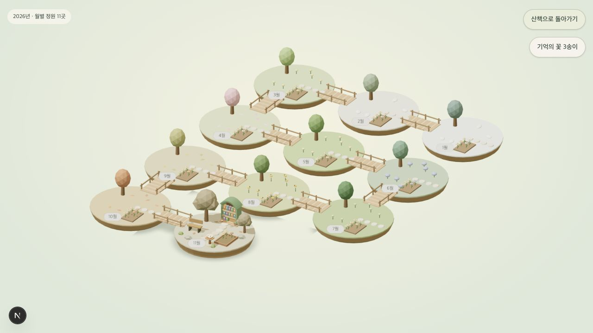

# 2026-11-19 프론트엔드 개발일지 — 세 땅씩 이어지는 계절 정원

## 오늘 반영한 사용자 결정

사용자가 월별 땅이 긴 일자가 아니라 세 개씩 연결되기를 요청했다. 1월부터 11월까지의 테마·더미 일기는 유지하고 배치를 세 칸씩 네 줄로 바꿨다. 현재 11월은 기존 책장과 일기장이 있는 원점에서 시작한다. 최종 작업은 [PR #32](https://github.com/Debuging-JunSeoPark/memory-garden/pull/32), [Issue #31](https://github.com/Debuging-JunSeoPark/memory-garden/issues/31)과 연결한다.

이전 [계절 정원 일지](2026-11-18-seasonal-monthly-gardens.md)의 일자 배치는 오늘 변경으로 대체된다. 월별 테마와 데이터 생성, 기존 기록 보존 결정은 유지한다.

## 세 칸을 연결하는 방식

단순히 세 칸마다 위치를 줄바꿈하면 3월과 4월이 대각선으로 떨어진다. 대각 다리를 추가하는 대신, 한 줄의 진행 방향을 번갈아 뒤집고 줄 끝에서 세로 다리로 다음 줄에 연결하는 지그재그를 선택했다. 현재 원점의 책장·화단 동선을 유지하기 위해 11월의 이전 월인 10월은 왼쪽에 둔다.

```text
3월 ← 2월 ← 1월
 ↓
4월 → 5월 → 6월
              ↓
9월 ← 8월 ← 7월
 ↓
10월 → 11월
```

11월 기준 행별 땅 수는 3·3·3·2다. 미래 12월을 위한 빈 땅이나 다리를 미리 생성하지 않는다. 행과 열에서 현재 월의 행·열을 빼고 간격 8을 곱해 월드 좌표를 계산한다. 이에 따라 11월은 (0, 0), 1월은 (8, -24)다. 연월 키와 일기 저장 키는 위치와 분리되어 있으며 배치를 바꾸어도 저장 데이터를 옮길 필요가 없다.

## 지형과 다리에 같은 연결 정보를 사용

기존에는 가로 다리만 있어서 x 좌표로 길과 월 영역을 계산했다. 이제 각 월의 x/z 좌표에서 연속한 두 월의 연결을 만들고, 다리의 중심과 가로·세로 여부를 계산한다. 이 연결을 지면 검사, 난간 충돌, 다리 모델이 함께 사용한다.

세로 다리는 기존 판자 모델을 y축으로 90도 회전한다. 충돌에서는 좌표를 다리의 길이 방향과 폭 방향으로 변환한다. 그래서 다리 길이·폭·난간 두께와 캐릭터 반경 규칙을 가로·세로에서 따로 복사하지 않는다. 원형 땅과 다리가 겹치는 입구에서도 독립 난간 판정을 유지한다.

같은 열에 여러 월이 생겨 x만으로는 월을 구분할 수 없다. 현재 캐릭터와 각 땅의 x/z 거리로 도착한 땅을 판별한다. 다리 위에서는 이전 월을 유지하고 반대쪽 원 안으로 들어오면 월이 바뀐다. 과거 월의 나무·꽃밭 충돌에도 각 월의 z 위치를 반영했다.

## 카메라와 전체 보기

산책 카메라는 기존 시선 방향과 배율을 유지하고 x와 z를 함께 따라간다. 두 좌표의 목표 이동에도 기존 감쇠 보간을 사용한다. 모션 감소 설정에서는 추가 보간 없이 필요한 위치로 이동한다. 화면 방향을 기준으로 계산하는 키보드·조이스틱 축은 바꾸지 않았다.

세 칸씩 묶인 전체 구조를 확인할 수 있도록 상단에 전체 정원 보기를 추가했다. 전체 보기에서는 캐릭터 이동을 멈추고 모든 열린 땅과 연결 다리, 월 이름을 보여 준다. 산책으로 돌아가면 같은 캐릭터 위치에서 이어간다. 전체 보기의 카메라 중심과 배율은 열린 땅들의 x/z 범위에서 계산한다.

산책 중에는 월 순서의 앞뒤 두 땅 대신 가로·세로 한 칸 이내의 땅을 렌더링한다. 실제로 화면에 가까운 다른 줄의 땅도 보이게 하기 위해서다. 다리는 양 끝 땅이 함께 표시될 때 그린다. 물리 지면과 충돌은 화면에 보이지 않는 월까지 포함해 항상 열린 전체 땅을 사용한다. 전체 보기에서는 최대 열두 땅을 모두 그리되 demand 렌더링을 유지한다.

## 월 이름 표시에서 발견한 React 문제

처음에는 Drei Html로 땅 위에 월 이름을 표시했다. 전체 보기에서는 정상적으로 보였지만 산책으로 돌아갈 때 별도 DOM root를 동기 해제하는 과정에서 React의 root unmount 경고와 removeChild 오류가 나타났다. 실제 개발 브라우저 로그에서 Html의 layout effect 정리 경로를 확인했다.

월 이름을 DOM root로 만들 필요가 없으므로 작은 CanvasTexture를 사용하는 Billboard로 바꿨다. 시스템 글꼴로 숫자와 월을 그린 뒤 3D 평면에 붙인다. 외부 폰트 파일을 받지 않고, 컴포넌트를 정리할 때 텍스처도 해제한다. 카메라 배율에 반비례해 크기를 조정해 전체 보기의 좁은 화면에서도 월 표시가 너무 작아지지 않게 했다.

새로고침한 개발 브라우저에서 전체 보기와 산책을 반복 전환한 뒤 새 error/warn 로그가 없는 것을 확인했다. 브라우저 보행 검사에도 pageerror 수집을 추가해 전체 보기 전환과 이후 월별 기록 읽기에서 처리되지 않은 오류가 없음을 확인한다.

## 함께 해결한 검사 경합

앞선 전체 검사의 사진 추가 시나리오가 간헐적으로 실패했다. 실패 시에는 사진 로딩 오류 메시지 없이 사진 수가 0이었고 재시도에서는 통과했다. 작성 화면은 날짜의 IndexedDB 조회가 끝나기 전까지 fieldset을 비활성화하는데, setInputFiles는 일반 사용자 클릭과 달리 이 상태를 자동으로 기다리지 않는다. 파일을 넣는 시점과 초안 초기화가 경합하는 테스트였다.

파일 입력이 활성화된 것을 먼저 확인하고 파일을 넣도록 시나리오를 조정했다. 앱에서 비활성화 중인 입력을 열어 버리거나 저장의 보호 조건을 제거하지 않았다. 조정 후 첫 CI 모드 전체 E2E는 30개가 재시도 없이 통과했다. 후속 전체 실행에서는 월별 저장·책장 보행 두 검사가 시간 초과 후 재시도에서 통과했고, 이 둘과 전체 보기·월별 산책의 데스크톱·모바일 여섯 검사를 따로 다시 실행해 모두 통과했다. 마지막 월 이름 크기 변경 이후 pnpm check와 전체 보기·월별 산책의 데스크톱·모바일 두 검사를 다시 실행해 통과했다. 이 두 검사에서는 처리되지 않은 페이지 오류도 없었다.

## 검증 근거

- 단위 검사: 11개 땅의 3·3·3·2 배치, 11월 원점, 다음 해 1월 경계, 열 개 연결의 양방향 왕복, 세 개 세로 다리, 양쪽 난간, 같은 열의 서로 다른 월 판별.
- 회귀 검사: 두 땅의 고정 fixture, 월별 예시 53개의 날짜 분포·중복·미래 날짜 제외, 기존 저장소와 에이전트 검사.
- 품질 검사: pnpm check의 포맷·린트·타입·단위 테스트 33개·저장소 검증·프로덕션 빌드.
- 브라우저 검사: 전체 보기 진입·복귀, 11월 꽃 하나에서 10월 꽃 두 개로 전환, 해당 월 본문 읽기, 귀환 후 현재 월 꽃 개수 복원, 페이지 오류 없음. CI에서는 소프트웨어 WebGL 장면이 경쟁하지 않게 worker 하나를 사용한다.
- 직접 사용: 더미 일기가 있는 11월에서 10월로 가로 이동한 뒤 세로 다리를 건너 9월에 도착했다. 월 표시와 카메라가 함께 바뀌고 꽃 다섯 개를 유지하는 것을 화면에서 확인했다.

독립 리뷰에서 중요한 결함은 발견되지 않았다. 최종 pnpm check와 관련 E2E 두 검사가 통과했다. 전체 30개 E2E의 재시도 내역 및 원격 CI 상태는 PR 검증란에 구분해 반영한다.

## 화면 기록



## 남은 개선

과거 월의 접촉 그림자는 원점의 정원과 같은 수준으로 적용되지 않는다. 전체 보기에서 먼 월의 산책으로 돌아올 때 카메라가 원점에서 잠시 보간하는 움직임도 후속 개선 항목이다. 월 중앙까지의 캐릭터 위치를 자동 판별하는 시각 검사는 추가하지 않았으며, 전체 연결의 물리 왕복과 실제 가로·세로 보행으로 확인했다.

현재 월은 정원에 들어오는 시점의 현지 달력으로 정한다. 열린 채 월이 바뀌는 순간의 갱신, 계정별 해금 이력, 이전 연도의 땅 보관, 선택 장식은 별도 범위다. 기존 연도의 기록은 책장과 WebGL 대체 조회에서 계속 읽는다.
