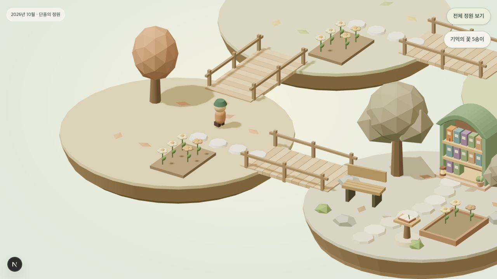

# 2026-11-23 프론트엔드 개발일지 — 카메라 복귀와 월별 그림자 보완

11월 21일에 시작한 [Issue #33](https://github.com/Debuging-JunSeoPark/memory-garden/issues/33)의 화면 보완을 재개했다. 이번 변경은 전체 보기 복귀, 과거 월 그림자와 모바일 상단 겹침에 한정한다. 여러 갈래 길과 각 땅의 책장은 후속 단계로 남긴다. 사용자는 책장에 해당 월의 책을 먼저 보여 주고 다른 월의 책도 열람할 수 있는 방식을 선택했다.

## 전체 보기에서 돌아올 때 원점이 보이던 이유

기존 카메라는 산책 모드의 position prop을 원점 기준 `[6.5, 6.8, 10]`으로 지정했다. 먼 월에서 전체 보기로 전환했다가 돌아오면 React Three Fiber가 이 값을 다시 적용하고, 이후 프레임에서 현재 캐릭터 위치로 감쇠 보간했다. 캐릭터의 위치 자체는 유지됐지만 카메라가 원점부터 잠시 움직여 몰입을 깨뜨렸다.

산책 프레임마다 마지막 카메라 위치를 ref에 저장하고, 보기 모드가 바뀌면 useLayoutEffect에서 위치와 주시점을 함께 적용하도록 바꿨다. 화면을 그리기 전에 마지막 산책 구도를 복원한다. 전체 보기와 책장·작성 화면의 전용 위치는 별도로 유지한다. 일반적인 React 재렌더나 창 크기 변경은 산책 위치를 초기화하지 않는다. 프레임별 위치를 React 상태로 올리지 않아 이동 중 전체 화면 재렌더도 추가하지 않는다.

처음에는 저장한 ref를 렌더 중 position 계산 함수로 전달했으나 react-hooks/refs 검사에 걸렸다. 이를 무시하지 않고 위치 적용을 layout effect로 옮겼다. 덕분에 렌더는 ref를 읽지 않고 Three 카메라 변경은 모드 전환 시점에 수행한다. cameraPosition 함수는 산책 위치의 보존과 전용 화면의 좌표 선택을 검사하는 데 사용한다.

## 과거 월에서 그림자가 빠지던 이유

기존 directional light의 그림자 영역과 ContactShadows 평면은 원점에 고정돼 있었다. 과거 월의 땅을 표시해도 그 위치는 그림자 범위 밖이었다.

산책 중에는 조명과 target을 현재 땅의 중심으로 함께 옮긴다. 둘을 같은 그룹에 두어 빛의 방향을 유지한다. target을 장면의 실제 Object3D로 등록해 월드 행렬도 함께 갱신한다. 그림자 카메라 반경은 기존 5를 유지한다. 책장·작성 화면은 원점의 독립 장면이므로 기존 중심을 사용한다.

전체 보기에서는 열린 땅들의 경계에서 중심과 범위를 계산한다. 11월의 11개 땅에서는 중심 (0, -12), 그림자 카메라 반경 18, 접촉 그림자 크기 32를 사용한다. ContactShadows는 현재 월 또는 전체 보기로 key를 나눠 장면이 바뀔 때 다시 한 번 계산한다. 산책 해상도 256, 전체 보기 512이며 frames=1을 유지한다. 땅마다 별도 그림자 렌더러를 추가하지 않았다.

## 좁은 모바일 화면

상단 월 이름은 화면 너비에서 버튼 자리를 제외한 폭 안에서 줄바꿈하도록 했다. 전체 보기 버튼과의 간격을 320px 화면에서도 검사한다. 기존 조이스틱과 하단 안내 위치는 유지했다.

## 검증과 화면 확인

11월 23일 Node 26에서 pnpm check와 CI 모드의 전체 브라우저 검사를 다시 실행했다. 단위 37개와 데스크톱·모바일 E2E 30개가 재시도 없이 통과했다.

단위 검사는 먼 월의 산책 위치를 전체 보기 이후 다시 선택하는 경우, 책장·작성 화면의 전용 좌표, 과거 월의 그림자 중심, 전체 보기의 범위를 다룬다. 브라우저 검사는 10월에서 전체 보기 진입·복귀, 월별 글 읽기와 11월 귀환, 페이지 오류, 320px에서 월 이름과 버튼의 비중첩을 확인한다. 기존 책장·일기·사진·WebGL 대체 흐름도 회귀 검사에 포함한다.

독립 코드 리뷰에서 중요한 발견 사항은 없었다. 조명 target의 행렬 갱신 순서와 카메라의 초기 진입·화면 전환·리사이즈 경로도 확인했다. 월 이름만으로는 실제 카메라 구도나 그림자를 증명할 수 없으므로 실제 10월 산책 화면과 복귀 직후 캡처를 직접 비교했다. 나무와 캐릭터의 그림자가 10월 지면에 생기고 같은 월의 구도로 복귀하는 것을 확인했다.

[전체 보기 진입 전 캡처](assets/2026-11-21/october-before-overview.png)와 아래 복귀 화면을 비교했다.

## 후속 단계

1. 열린 땅의 상하좌우 이웃을 연결해 여러 경로를 만든다. 기존 세 칸 배치는 유지하며 길 입구와 책장·나무·화단이 서로 막지 않도록 배치를 검토한다.
2. 각 땅에도 책장을 두고 가까이에서 연다. 해당 월의 책을 먼저 배치하되 다른 월 책과 튜토리얼도 열람할 수 있게 한다.

후속 두 단계는 이번 코드에 포함하지 않았다. 최종 검사 결과와 필수 CI 상태는 연결된 PR에 기록한다.
