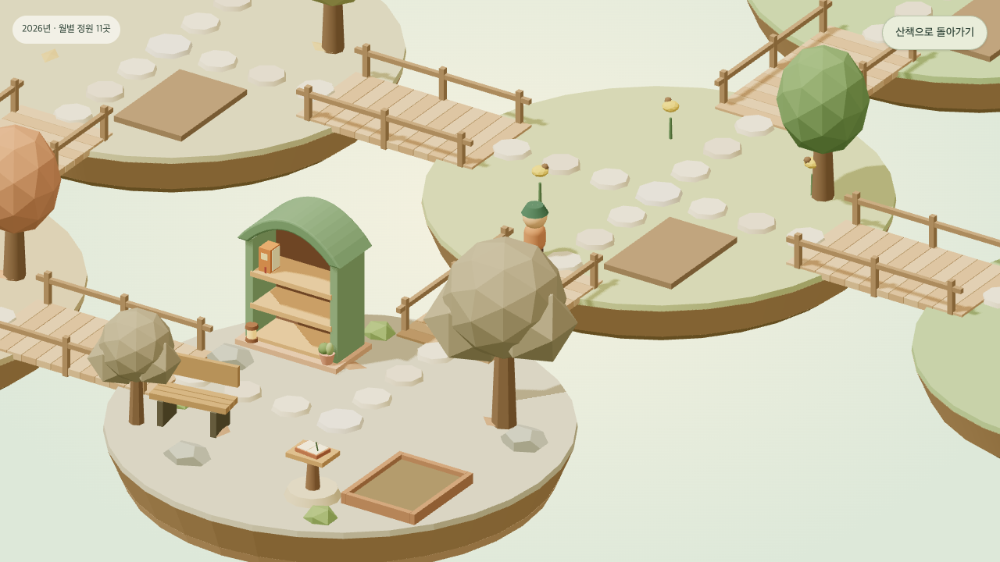
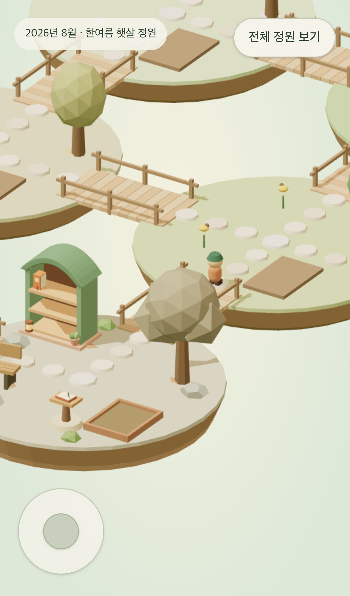
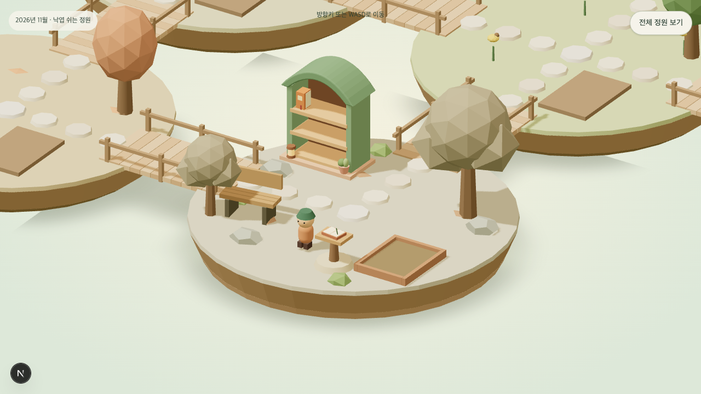
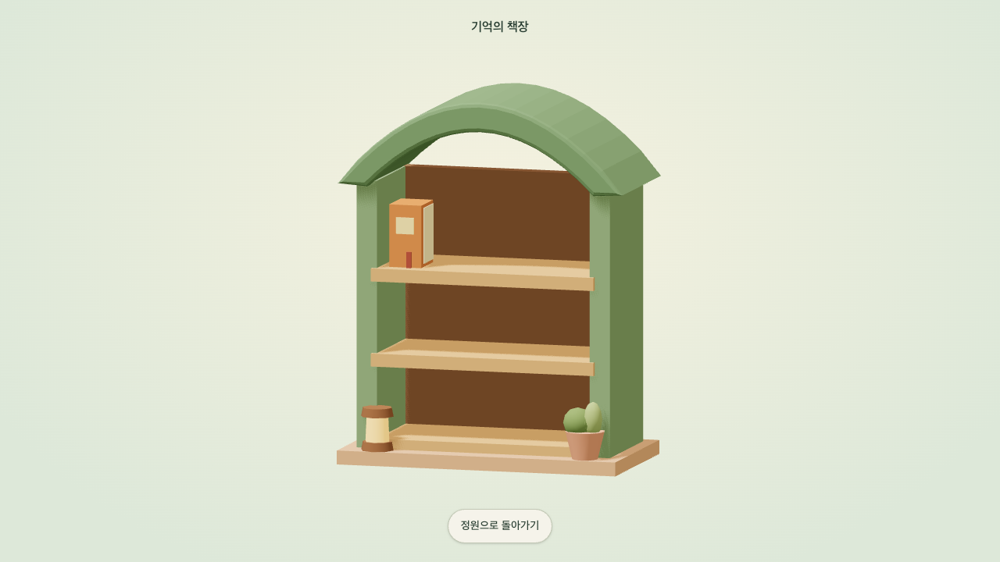

# 2026-11-24 프론트엔드 개발일지 — 이웃 월 정원을 잇는 여러 산책길

## 오늘의 범위와 시작점

먼저 PR #37의 필수 CI 성공과 정확한 head를 확인한 뒤 Squash Merge했다. 병합 커밋은 `0357cf2`이며 로컬 main도 fast-forward로 맞췄다. 그 위의 `codex/garden-neighbor-paths`에서 [Issue #38](https://github.com/Debuging-JunSeoPark/memory-garden/issues/38)을 진행했다. 이전 단계의 카메라 복귀·월별 그림자 보완은 유지한다.

사용자는 기존 한 줄의 길을 따라 돌아가는 이동이 불편하며 한 땅에서 여러 땅을 갈 수 있기를 원했다. 세 땅씩 묶는 기존 배치는 유지하고 열린 상하좌우 이웃을 모두 연결하는 단계를 먼저 구현했다. 각 땅의 책장은 다음 PR이다. 그 책장은 해당 월의 책을 우선하고 다른 월과 튜토리얼도 열람하도록 하는 사용자 선택을 유지한다.

## 기존 설계가 불편했던 이유

땅 좌표는 이미 3열이었지만 `gardenBridges`는 배열에서 연속된 월만 연결했다. 눈으로는 위아래에 인접한 땅이 있어도 순서상의 이웃이 아니면 다리가 없었다. 예를 들어 11월 바로 북쪽은 8월인데, 기존에는 11→10→9→8월로 돌아가야 했다.

땅의 좌표를 다시 생성하는 방법, 중앙 허브를 추가하는 방법, 기존 위치에서 상하좌우 이웃을 연결하는 방법을 비교했다. 좌표 재생성과 허브는 카메라·월 위치·다리 교차 규격까지 바꾸고 사용자가 요청한 3열 형태도 흔들 수 있다. 기존 위치의 인접 그래프를 선택하면 월 테마·데이터 연결을 유지하면서 불편을 직접 해결할 수 있다. 대각선은 길이와 난간 회전 규격을 추가해야 하므로 도입하지 않았다.

## 연결 그래프와 지면

모든 인덱스 쌍을 `from < to`로 한 번씩 검사한다. x 차이가 8이고 z 차이가 0이거나, z 차이가 8이고 x 차이가 0인 경우만 다리를 만든다. 단순히 맨해튼 거리만 검사하면 대각선 반칸 좌표도 섞일 여지가 있어 두 축 조건을 명시했다.

기존 `GardenLink`의 중심 x/z, vertical, from/to 계약을 유지했다. 렌더링, 보행 지면, 난간 충돌이 같은 생성 함수를 사용하므로 보이지만 못 걷거나 보이지 않는데 걷는 별도 연결 목록을 만들지 않는다. 현재 최대 12개 땅에서 쌍은 66개라 별도 그래프 캐시나 상태 저장소는 도입하지 않았다.

11월은 가로 7개와 세로 8개, 합계 15개 다리다. 기존 10개에서 5개가 추가된다. 새 연결은 2↔5, 3↔4, 4↔9, 5↔8, 8↔11월이다. 12월이 열리기 전에는 그 빈 자리에 지면이나 다리가 생기지 않는다. 1·2·3·4·11·12월의 연결 수는 각각 0·1·2·3·15·17개다.

여러 다리가 같은 from을 공유하게 되므로 React key도 from 하나에서 `from-to` 쌍으로 바꿨다. 이 변경이 없으면 중복 key로 다리 재사용과 갱신이 잘못될 수 있다.

## 입구를 비우는 배치와 실제로 발견한 충돌

첫 단위 검사는 새 연결을 생성하지 않는 구현에서 5건 실패했다. 그래프만 확장하자 연결 검사는 통과했지만 전체 다리 왕복은 여전히 목적지 약 2.75단위 앞에서 멈췄다. 원래 북쪽 중앙의 책장이 8월에서 11월로 들어오는 길을 막고 있었다. 기존 동쪽 화단도 중심선을 가로막아 새 분기 구조에 맞지 않았다.

책장을 북서쪽 `(-1.65, -1.65)`로 옮기고 나무·벤치를 모서리 쪽으로 조정했다. 큰 나무는 `(1.9, -1.2)`를 홈·과거 월에서 함께 사용하고 작은 나무는 홈 남서쪽에 둔다. `garden-layout.ts`의 위치 값을 모델과 보행 충돌에서 함께 읽도록 해 보이는 물체와 보이지 않는 장애물이 다른 곳에 남는 문제를 줄였다. 양쪽 입구까지 포함한 난간 충돌 규격은 유지한다.

독립 리뷰는 처음 옮긴 화단 `(1.45, 1.45)`의 왼쪽 울타리가 일기장 받침과 겹친다는 문제를 찾았다. 이동 성공만으로는 장면의 시각적 충돌을 확인할 수 없었다. 일기장 받침 반경 0.4와 화단 외곽 사각형이 교차하지 않고, 가장 먼 울타리 모서리가 땅 반경 3.24 안에 있는지 검사했다. 수정 전에는 받침에서 화단까지의 거리가 0으로 실패했다.

최종 화단은 `(1.9, 1.25)`에 두고 외곽 깊이를 1.67에서 1.47로 줄였다. 모델의 울타리·흙·꽃 간격도 이에 맞췄다. 공유 width/depth가 모델과 기하 검사의 입력이 된다. 받침과 화단 외곽 사이의 거리는 약 0.45로 반경보다 크고, 가장 먼 모서리는 약 3.19로 지면 안에 남는다. 화단 충돌 영역은 동쪽 중심 통로에서 z=0.36 이후에 시작한다. 화단과 가까워진 돌·덤불도 옮겼다.

과거 나무 충돌 테스트는 옛 나무 좌표를 가리켜 실패했다. 충돌을 없애지 않고 새 실제 위치인 x=-6.1의 나무 앞에서 같은 북쪽 이동이 차단되는지 검사하도록 고쳤다.

## 길과 카메라

홈의 긴 세로 돌길과 과거 월의 한쪽 돌길을 공통 `GardenPaths`로 교체했다. 각 땅에 실제 연결된 다리만 골라 그 방향으로 디딤돌 세 개와 중앙 돌 하나를 놓는다. 없는 12월을 향하는 길이나 대각선 돌길을 만들지 않는다. 낮은 계절 장식도 x/z 중심 통로를 비운다. 안내 버튼이나 지도 패널을 늘리는 대신 장면 안에서 출구가 읽히도록 했다.

책장을 옮기면서 확대 카메라만 절대 좌표에 남겨 두면 책장이 화면 옆으로 밀린다. 기존 책장과 카메라의 상대 x/z 거리 1.78/6.12를 유지하도록 계산했다. 단위 검사에서 이전 절대 좌표로는 x 거리가 3.65가 되어 실패하는 것을 먼저 확인한 뒤 고쳤다. 산책 카메라 pose 복원과 전체 보기 구도는 그대로 사용한다.

이동 좌표는 기존 ref·useFrame 흐름을 유지한다. 새 전역 상태, 이벤트 구독, 데이터 요청, 라이브러리는 추가하지 않았다. FSD의 garden-preview 슬라이스 내부에서 처리한다.

## 검증

Node 26에서 최종 `pnpm check`가 통과했다. 단위 45개, 포맷·lint·type-check·저장소 검증과 프로덕션 빌드를 포함한다. 수정 후 `CI=1 pnpm test:e2e --retries=0`도 데스크톱·모바일 32개가 재시도 없이 통과했다(1.7분).

- 단위: 연결 그래프의 정확한 인덱스 쌍, 경계 월·빈 배열, 15개 다리 전체 왕복, 지면 이탈 방지, 양쪽 입구 난간, 월 전환과 책장 카메라, 화단과 일기장·땅의 분리.
- 브라우저: 새 11월↔8월 지름길을 키보드와 실제 터치 조이스틱으로 왕복한다. 이동 입력을 끝낸 뒤 캡처하며, 전체 보기·산책 복귀와 페이지/콘솔 오류도 검사한다.
- 책장: 새 위치에 가까이 간 뒤 Enter, 선반, 별도 안내서 선택, 책 덮기와 산책 귀환을 데스크톱·모바일에서 확인한다.
- 기존 기능: 월별 꽃·기록, 사진 저장과 복구, 일기 작성, 날짜 모아보기, WebGL 대체 흐름을 전체 E2E에 포함한다.
- 독립 리뷰의 추가 탐색은 12개월 배치에서 총 186개 방향별 중심 간 보행을 확인했다. 이 탐색은 커밋된 11월 15개 양방향 검사와 별개의 추가 근거다.

검사의 한계도 기록한다. 모바일 지름길 검사는 도착과 귀환은 확인하지만 중간 월 이력 Set은 데스크톱에서만 채운다. 모바일에서도 중간 전환 전체를 수집하는 강화는 Minor 후속으로 남겼다. 모든 인접 연결과 빈 슬롯의 물리적 제한은 단위 검사에서 확인한다.

## 화면과 남은 단계

최종 캡처는 아래에 보관한다. 브라우저 검사는 개인 데이터가 없는 독립 컨텍스트를 사용하며, 사용 중인 브라우저의 IndexedDB를 덮어쓰지 않는다. 기존 개발용 예시와 개인 일기 저장 구조도 변경하지 않았다.

다음 기능 단계는 각 땅의 책장이다. 이번 변경을 별도 Issue/PR로 검토한 뒤, 월별 접근 위치와 해당 월 우선 책 정렬을 후속으로 진행한다.
