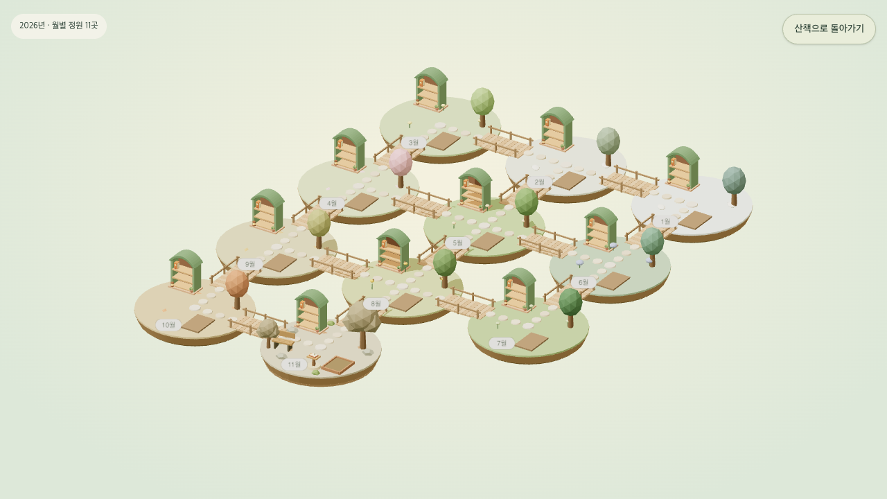
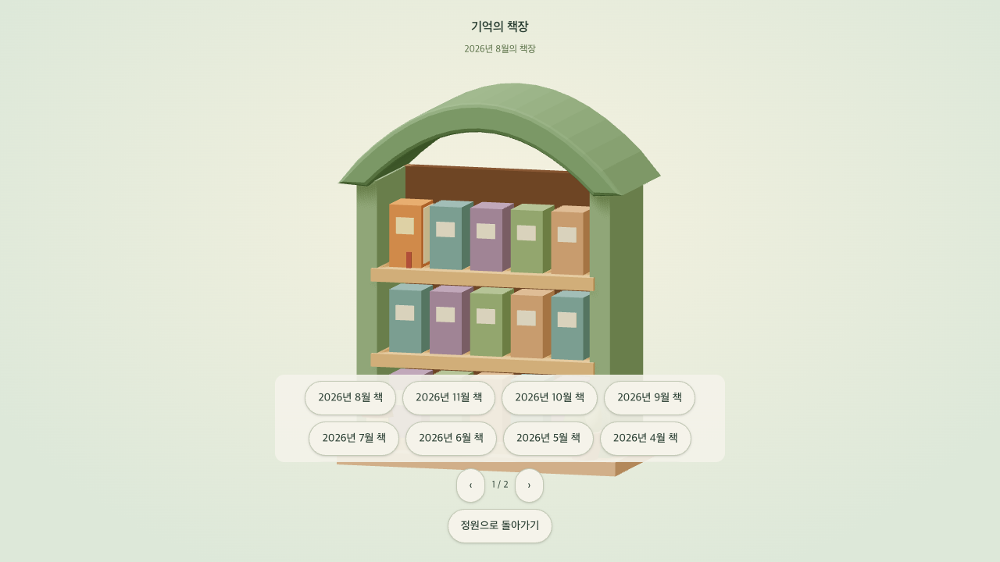
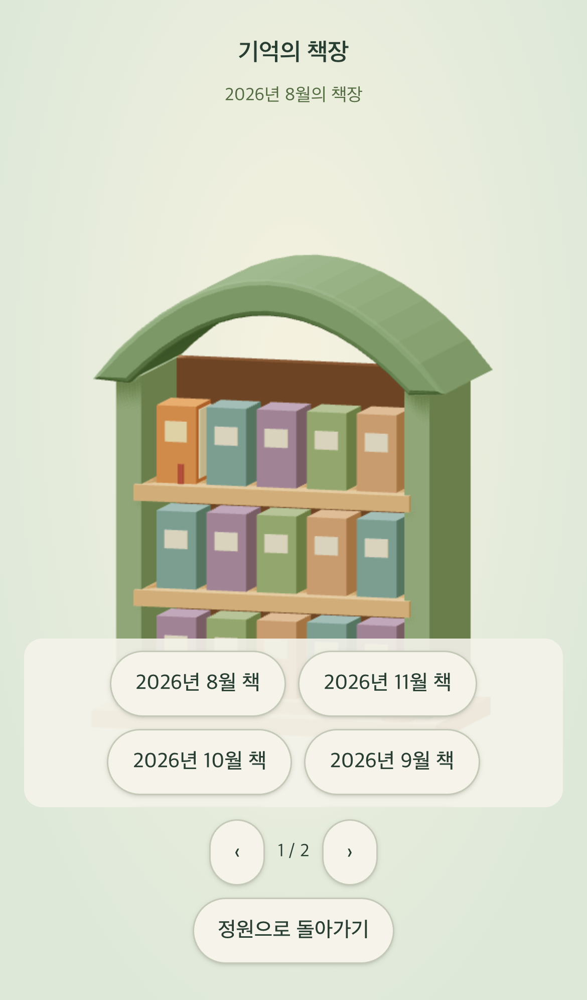

# 2026-11-25 프론트엔드 개발일지 — 각 월 정원에서 여는 책장

## 오늘의 범위와 출발점

사용자는 이전에 정한 다음 단계를 별도로 나누어 하나 진행해 달라고 요청했다. 이번 결과는 “각 땅에서 그달의 책장을 열고 기록을 읽는다”는 한 기능으로 묶는다. 캐릭터 외형, 새로운 장식, 데이터 동기화 등은 섞지 않았다.

먼저 PR #39의 최신 head `1a20966`와 필수 Validate repository 성공을 확인했다. head SHA를 지정한 Squash Merge 결과는 `efe8447`이다. main을 fast-forward한 뒤 `codex/monthly-garden-bookshelves`를 만들었다. [Issue #40](https://github.com/Debuging-JunSeoPark/memory-garden/issues/40)에 이번 목표를 기록했다. 기준 단위 검사는 45개가 통과했다.

## 기존 구조와 설계 고민

홈 정원에는 3단·단별 5칸의 공통 책장 모델이 있었지만, 과거 땅을 그리는 GardenNextPlot에는 책장이 없었다. 충돌 판정과 가까움 판정도 원점의 한 책장만 계산했다. 단순히 모델을 복제하면 캐릭터가 과거 책장 안으로 통과하고 앞에 서도 선반을 열지 못한다.

확대 선반, 안내서와 월별 기록 읽기는 이미 공통 UI를 사용했다. 월별로 각각의 선반 상태와 기록 목록을 보유하는 방식은 저장 데이터·페이지·선택 상태가 중복된다. 반대로 책장 클릭 즉시 그달 기록으로 보내는 방식은 먼저 선반을 보고 책을 고르려는 사용자 요청과 맞지 않는다.

공유 모델을 각 땅의 로컬 좌표에 두고, 여는 순간의 월만 공통 viewport에 전달하는 방식을 선택했다. 산책의 책장과 선반 확대 장면은 같은 모델을 재사용한다. 확대 장면은 원점의 독립 무대이므로 먼 월의 좌표로 카메라를 이동시키지 않는다. 닫을 때는 이전 단계의 walkingPose ref로 원래 산책 구도로 복귀한다.

## 모델·충돌·접근을 함께 확장

책장은 모든 땅의 북서쪽 로컬 좌표 `(-1.65, -1.65)`에 둔다. 앞선 PR에서 상하좌우 입구를 비워 둔 자리이며 나무·화단과도 분리된다. 과거 땅 그룹에 공통 책장을 추가하면 모델은 부모 땅의 x/z만큼 평행 이동한다.

충돌도 열린 전체 땅을 순회해 같은 이동량을 적용한다. 반폭 0.96, 반깊이 0.59의 기존 책장 장애물 규격을 유지했다. 접근 범위는 책장 앞 z+0.83 지점에서 반경 0.74다. isNearShelf에 현재 땅 좌표를 전달하고 원격 책장이나 땅 중심을 접근으로 잘못 판정하지 않는지 검사했다.

변경 전 검사는 1월의 실제 책장 앞에 서도 접근을 인식하지 못했고, 그 위치에서 북쪽으로 걸으면 모델 안으로 들어갔다. 두 실패를 확인한 뒤 전체 월의 이동량을 적용했다. 모든 월의 접근·진입 차단·앞으로 빠져나오기와 기존 15개 다리 왕복을 함께 검사한다. 길을 열기 위해 책장 충돌을 빼는 방법은 사용하지 않았다.

## 원격 클릭과 이동 키를 함께 고려

같은 주변 장면에 여러 책장이 보이기 때문에 nearShelf 하나만 보고 모든 책장의 클릭을 켜면 멀리 있는 책장도 열릴 수 있다. 클릭 콜백은 가까움과 `region === index`, 전체 보기 해제 조건을 모두 만족하는 땅에만 연결한다.

키보드 Enter는 player의 현재 region ref가 가리키는 월 키를 전달한다. openShelf(month)는 useCallback으로 안정된 함수를 유지하고 월 키를 호출 인자로 받는다. region을 캡처해 함수를 매번 만들면 월 도착 시 player의 키보드 effect가 정리되면서 누른 이동 키가 지워질 수 있다. player의 frame ref와 기존 이동 방식을 유지해 이 문제를 피했다.

지도 버튼은 인자 없는 openMapShelf 래퍼를 사용한다. DOM onClick 이벤트가 월 키로 들어오지 않게 하고, 지도에서는 null 문맥으로 기존 전역 책장을 연다. WebGL 대체 경로의 전체 연도 접근도 유지한다.

## 해당 월 우선, 안내서와 다른 연도 보존

월별 책 배열은 저장소에서 받은 날짜 역순을 기본으로 한다. prioritizeShelfMonths는 선호 월의 인덱스를 찾아 그 원소만 맨 앞으로 이동한다. 나머지의 상대 순서와 날짜 배열을 유지하고 입력을 수정하지 않는다. 해당 월이 없거나 목록이 비어 있으면 가짜 책을 만들지 않는다.

안내서는 월 배열에 섞지 않고 기존 맨 위 첫 칸을 유지한다. 그 다음 칸부터 현재 땅의 월 책, 나머지 월 책이 이어진다. 선반을 여는 순간에는 페이지를 0으로 초기화하므로 이전에 마지막 페이지를 보았더라도 그달 책을 먼저 만난다. 선반 안에서 안내서나 일기를 닫으면 진입 월과 페이지를 유지한다.

원경 책장에는 안내서와 해당 월 책만 꽂는다. 모든 원경 책장에 다른 연도의 14권씩을 반복해서 그리는 비용을 줄이고 땅과 월의 관계도 명확하게 한다. 선반을 열면 전체 월 목록과 14권 페이지 이동을 제공한다. 16권 검사에서는 첫 페이지 14권과 다음 페이지 2권이 합쳐 원본 기록을 모두 포함하며, 다른 연도 기록도 빠지지 않는지 확인했다.

## 조회 실패와 빈 달을 구분한 리뷰 수정

초기 구현은 months에 현재 월이 없으면 “아직 이 달의 기록이 없어요”를 표시했다. 독립 리뷰에서 초기 로딩과 읽기 실패도 빈 배열로 보인다는 문제를 찾았다. 실패 안내와 빈 달 안내가 동시에 나타나면 사용자가 저장 기록을 잃었다고 오해할 수 있다.

getAllKeys 조회를 한 번 실패시키는 브라우저 검사에서 모순된 빈 달 문구가 실제로 나타나는 것을 확인했다. recordsLoaded를 성공 조회 후에만 켜고 실패·새로고침에서는 끈다. 빈 달 안내는 성공한 목록에서만 표시하며 오류·다시 불러오기 흐름은 유지한다. 재시도에 성공해 실제 목록이 비어 있을 때 비로소 빈 달 안내를 보여 준다.

## 실제 산책 검사에서의 입력 문제

첫 브라우저 실행에서 모바일의 8월 열람과 빈 월 처리는 통과했지만, 데스크톱은 책장 접근 중 9월로 벗어났다. 테스트가 북쪽 보행 매크로의 끝에서만 월 도착을 확인해, 월 경계를 넘은 뒤에도 남은 대기 시간 동안 이동을 계속했다. trace에는 450ms+170ms의 조합과 브라우저 처리 지연이 남아 있었다. 책장 접근에는 도착 위치 편차가 영향을 준다.

데스크톱 검사는 DOM의 월 표시를 프레임마다 관찰하고, 도착하면 현재 대기를 종료해 방향키를 정리하도록 바꿨다. 다리 입구를 벗어난 뒤 책장 쪽으로 돌며, 도착이나 접근 캡처는 항상 입력을 끝낸 뒤에 수행한다. 저장 좌표를 테스트에서 강제로 바꾸거나 순간이동 API를 추가하지 않았다. 테스트의 이동 경로와 제품의 충돌 규칙을 구분해 확인했다.

## 검증과 한계

Node 26에서 최종 pnpm check가 통과했다. 전체 데스크톱·모바일 E2E 38개도 `CI=1 pnpm test:e2e --retries=0`으로 재시도 없이 통과했다(2.2분). 단위 검사 50개에는 우선 월·없는 월·빈 목록·16권과 이전 연도, 각 월 책장의 충돌과 접근, 기존 다리·카메라 검사와 저장소 검사가 포함된다. pnpm check는 포맷·lint·타입·검사·저장소 검증·프로덕션 빌드까지 다룬다.

브라우저에서는 실제 입력으로 8월에 도착해 선반을 연다. 안내서 자동 실행 여부, 8월 우선 순서, 8월과 11월 기록 본문, 다음 페이지의 이전 연도 책, 8월 산책 복귀, 재진입 시 첫 페이지 초기화를 확인한다. 기록 없는 달과 조회 실패 후 재시도도 별도 검사한다. 기존 일기·사진·모아보기·WebGL 대체 경로를 전체 회귀 검사에 포함한다.

독립 리뷰에서 기록 저장 형식·개인 데이터 변경은 없음을 확인했다. Minor 후속으로 모바일 3D 책장 모델의 실제 탭 자동화를 남겼다. 현재 모바일 검사는 실제 터치 조이스틱 접근 뒤 Enter로 선반을 열어 월 문맥과 열람·귀환을 확인한다. 모델의 클릭 콜백 연결은 코드 리뷰로 확인했으며, 자동 검사가 실제 메시 탭까지 다룬다고 주장하지 않는다.

사용 중인 브라우저의 실제 일기와 사진은 읽거나 덮어쓰지 않았다. 브라우저 검사는 독립 컨텍스트에 제목·본문에 가상 표시를 붙인 예시만 저장한다. 다음 단계로 새로운 기능을 시작하지 않고 이 기능의 별도 PR과 검사 결과를 보고한다.

## 최종 화면

11월 26일 후속: [모바일 책장 직접 탭 검증](2026-11-26-mobile-shelf-tap.md)에서 Enter를 우회하지 않는 실제 캔버스 탭 경로를 추가하고 재시도 없이 통과했다. 위 Minor 자동 검사 보완은 이 후속 변경에서 해결했다.
